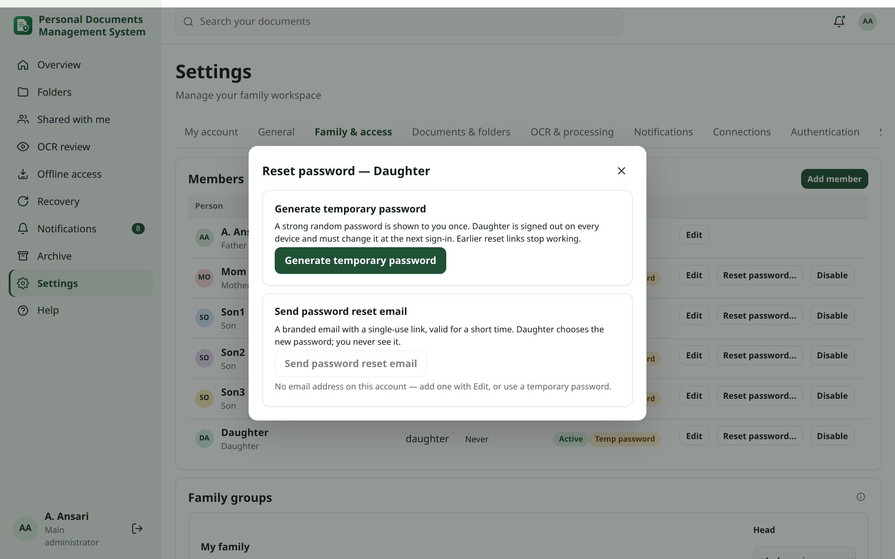
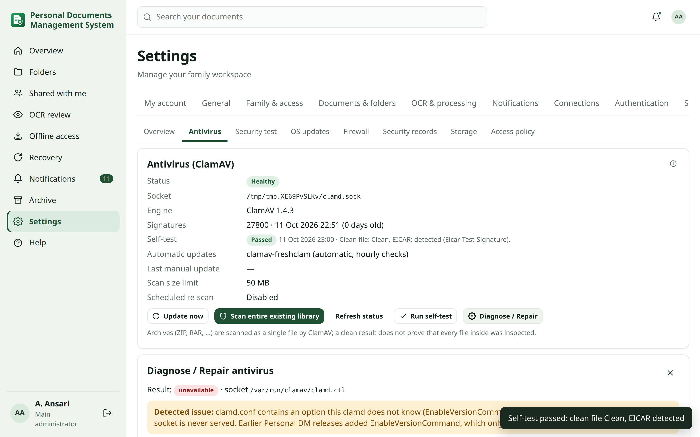

# Administrator guide

For whoever installs and runs Personal Documents Management System (the **main administrator**). Each section summarises what to do
and links to the detailed guide (also available in the app under **Help**). Commands run as root inside the
container (`pct enter <id>` from the Proxmox host).

## 1. Install and first-run setup {#setup}

1. Create a Debian 13 LXC (2 vCPU, 4 GB RAM, 50 GB, nesting on). `scripts/proxmox-create-lxc.sh` does it from the
   Proxmox host.
2. Inside it, as root, run the one-line installer:
   `bash -c "$(curl -fsSL https://raw.githubusercontent.com/atikansari-ghr/Personal-DM/main/personal-DM.sh)"`.
   You can also clone the repository and run `bash personal-DM.sh` or `bash scripts/easy-install.sh`. It asks for:
   - the domain
   - the proxy address
   - the NAS details (they become a NAS backup destination)
   - the backup time

   Then it installs and checks everything, including the ClamAV antivirus (about 1.2 GB of memory; skip it with
   `--without-antivirus` on smaller machines) and the root host helper used by Settings → Security.
3. Configure the reverse proxy (below), open the HTTPS address and enter the setup code
   (`personaldocs setup-token` prints a new one).
4. The wizard creates **only the Main Administrator** (your name, username and password; relationship label and email
   are optional). No default family accounts are created.
5. The next step, **Add family members (optional)**, adds zero, one or many people (name, username, relationship,
   optional email and password), or **Skip for now**. Members without a password get a generated temporary password,
   shown once; everyone must choose their own at first sign-in. You can add people later in **Settings → Family &
   access → Add member**.

Guides: [installation](guides/installation.md), [setup](guides/setup.md), [private GitHub access](guides/private-github.md).

## 2. Family, extended family and permissions {#family}

**Settings → Family & access**:
- Add or deactivate members. Deactivating never deletes the person's documents; they stay in their library, where
  you can move them. Members cannot be deleted from the web interface.
- **Reset password…** on a member's row (also in **Settings → Users** for the Administrator role), after a recent
  confirmation (password or passkey):
  - **Generate temporary password**: 16 random characters, shown to you **once** with **Copy**; only its hash is
    stored and it is never emailed. The person must choose a new password at the next sign-in and is signed out on
    every device; earlier reset links stop working. Pass it on in person or another safe channel, then click **Done —
    I have passed it on**.
  - **Send password reset email**: a branded email with a single-use link, valid for `auth.reset_token_minutes`
    (default 30). Needs SMTP and an email address on the account; on an Internet deployment only over `https://`.
  - **Main Administrator protection:** an Administrator cannot reset a main administrator's password (the row shows
    **Protected**); only another main administrator can, or the console with `sudo personaldocs recover-admin
    USERNAME`. Nobody resets their own password here (use My account → Password & security).
  - Audited as `family.password_reset_by_admin` (method `temporary_password`, never the password) or
    `family.password_reset_email`; the person is notified (never with the password).

  

  Guide: [password reset](guides/password-reset.md).
- Reset 2FA (removes the authenticator app, passkeys and recovery codes; audited, and the person is notified).
- Manage profile photos.
- Optional folder templates.
- **Administrator role** (Edit → *Administrator*): for a trusted person who helps with security and operations. An
  Administrator gets **Settings → Security** (the security center) and the administrator-only security
  notifications. The role **never grants access to any document or folder**; permissions stay as they are. Only the
  main administrator can set it (or an authentik group mapping, see below), and the main administrator keeps every
  other setting.

**Extended family:** groups with a head, and delegation scopes (documents, folder permissions, receive reminders).

**Permissions:**
- Default-deny with nine capabilities, set on folders (inherited) or documents (exceptions).
- **Who has access** explains every grant.
- Moving an item that would give more people access needs *manage permissions*.

Guides: [setup](guides/setup.md), [extended family](guides/extended-family.md).

## 3. Authentication policy {#authentication}

**Settings → Authentication**:
- Allow authenticator apps (TOTP) and passkeys.
- **Passkey sign-in mode** (`auth.passkey_mode`): **Passwordless** (default) shows **Sign in with Passkey** on the
  first sign-in screen, and a passkey verified with fingerprint, face or PIN signs the person in on its own;
  **Password + Passkey** uses passkeys only after the password. It replaces *Allow passwordless passkey sign-in*; on
  upgrade an explicit earlier choice is kept (saved off → Password + Passkey). After adding a discoverable passkey in
  passwordless mode, passwordless is turned on for that account; each person can turn it off under Passkeys. The main
  administrator's password, recovery codes and `sudo personaldocs recover-admin USERNAME` keep working in both modes.
- People may sign in with their email address instead of the username when it belongs to exactly one active
  account.
- **Require two-step verification** for nobody, administrators or everyone. *Administrators* covers the main
  administrator and every account with the Administrator role. People without one are guided to set it up; nobody is
  locked out.
- Re-confirmation window for sensitive changes.
- Optional Google sign-in (linking only; no automatic accounts).
- Optional **authentik** sign-in (**External identity providers**): OpenID Connect with PKCE, state and nonce, an
  HTTPS issuer only, and the client secret stored encrypted. Local sign-in always stays available. People link their
  own account in My account → Password & security (after confirming their password); accounts are never linked by a
  matching email. You see and can revoke every link; the account and its documents are kept. **Account provisioning**
  defaults to *Existing Personal DM accounts only*; *Create accounts automatically* creates member accounts, never a
  main administrator. **Map authentik groups to roles** (off by default) assigns only Member or Administrator, never
  touches the main administrator and never grants document permissions; every change is audited. The redirect URI
  is `https://<your address>/api/auth/authentik/callback`.

Any change to these settings is a critical notification to administrators.

**Passkeys** only work on the HTTPS address in `PD_PUBLIC_ORIGIN`. Changing the domain later makes existing passkeys
unusable. `personaldocs doctor` checks the relying-party ID and origin.

Guides: [passkeys](guides/passkeys.md), [authenticator and recovery](guides/totp-recovery.md), [Google](guides/google.md),
[authentik](guides/authentik.md#setup).

## 4. Email and Telegram {#channels}

- **Settings → Connections:** SMTP host, port, security and sender; Telegram bot token and username. Use
  **Send test**.
- Each person adds an email address to their profile and links their own Telegram from **My account →
  Notifications**.

Guides: [SMTP](guides/smtp.md), [Telegram](guides/telegram.md).

## 5. Notification policy {#notifications}

**Settings → Notifications**:

| Setting | Purpose |
|---|---|
| Critical notifications | Events members cannot turn off. Default: account security changes, sign-ins from new countries, failed-sign-in alerts, access/authentication policy changes, failed backups, integrity problems |
| Channels for critical notifications | Where critical events always go (default in-app + email + Telegram) |
| Notification Detail Level | `notifications.detail_level`, default **Full Details**: complete names, document numbers and IP addresses, only for recipients who may already see them. **Minimal Details**: a summary and a link. People can override it for themselves ([details](guides/notifications.md#detail-level)) |
| Push notifications (PWA) | `notifications.push_enabled`, default on. Lets people turn on Web Push per device; needs the HTTPS address. Off: push is not offered and nothing is sent |
| Repeat cooldown for recurring conditions | `notifications.repeat_cooldown_hours`, default 24 (1–168). Antivirus unavailable, stale signatures, failed signature updates and storage warnings are not repeated to the same person within this time; new critical events are always sent at once |
| Expiry reminder days, send time, recipients | When and to whom reminders go |
| Default / required channels for expiry reminders | Starting point and locked channels for reminders |

- **Delivery problems** lists anyone who would miss required notifications (no email address, Telegram not linked).
  If email or Telegram is not configured at all, it says so, and those messages are recorded as *skipped*.
- **Delivery history** shows every external message (email, Telegram, push) with its state (queued, retrying with
  the next try, sent, failed, skipped), attempts, "accepted by the provider" when the provider returned a message id,
  and errors with credentials removed; filter by channel and state. Providers do not report delivery to the device.
- **Templates** (main administrator): per event and channel, change the title/subject, heading, summary (plain text
  with allowlisted placeholders such as `{document_type}` or `{days_remaining}`), icon, severity shown (critical
  events never below Warning) and action labels. No code or HTML is accepted. Live previews show Email (desktop and
  mobile), Telegram, In-app, Push and Plain text; **Reset to default** removes an override. **Send a TEST message to
  yourself** sends the draft with sample data, marked TEST, on the channels you choose and creates no real event.
  Saves, resets and TEST sends are audited. **Branding name** (email header, up to 60 characters) and **Footer / help
  text** (up to 300 characters) can be set per event and channel too. Security events (sign-ins, passkeys,
  authenticator app, password reset requested, administrator reset, temporary password issued, password reset
  completed, account locked, Google and authentik links) carry **mandatory security text** that is always shown (red
  box in email, `IMPORTANT:` lines in plain text, bold ⚠️ lines in Telegram, a red note in-app) and is locked in the
  editor. See [security templates](guides/notifications.md#security-templates).
- Members choose everything else themselves, per event and channel, and turn on push per device. Push is never added
  to anyone's channels automatically; add it to *Channels for critical notifications* only if you want critical
  events on push too.
- Bulk uploads and imports produce one summary message per person.
- Release from quarantine is never offered in a message; it stays in Settings → Security → Antivirus.

Guides: [notifications](guides/notifications.md) ([templates](guides/notifications.md#templates),
[delivery history](guides/notifications.md#delivery), [noise control](guides/notifications.md#noise),
[privacy](guides/notifications.md#privacy)) and [critical and optional notifications](guides/expiry-rules.md#critical).

### Discord, WhatsApp Personal, routing and delivery health {#channels-t}

- **Settings → Connections** starts with a card per provider (In-App, Email, Telegram, Push, Discord, WhatsApp) and
  its real state: Connected, Configured, Disabled by Admin, Available – not configured, Degraded or Not installed
  ([provider cards](guides/notifications.md#providers)).
- Turn **Discord webhooks** on under Settings → Connections. Each person then adds their own webhook ([Discord](guides/discord.md)).
- **WhatsApp Personal** is experimental and unofficial. It needs the optional bridge
  (`sudo personaldocs whatsapp-bridge install`), and each person links their own phone. It only sends notifications to
  that person ([WhatsApp Personal](guides/whatsapp-personal.md)).
  - The **Bridge service** table shows whether the bridge is installed, its systemd state, whether Personal DM can
    reach it, its version and protocol, compatibility, available updates, linked people (counts only) and the last
    check. It finds a running bridge even before you turn WhatsApp on (*Installed and running – turned off*).
  - Turning **WhatsApp Personal** on takes effect at once, without a restart.
  - **Run Diagnostics** checks DNS, network access to WhatsApp, the system time, session storage and each person's
    pairing state, without showing any secret. **Restart Bridge** restarts the service; sessions resume by themselves.
  - Bridge 1.1.0 fixes phones that stayed on *Connecting*: run `sudo personaldocs whatsapp-bridge update` once
    ([updates](guides/whatsapp-personal.md#updates)).
- Neither channel is turned on for anyone automatically.
- People choose channels per category, fallback chains, quiet hours and digests themselves. **Settings →
  Notifications → Notification delivery health** shows counts per channel only, never message content
  ([notifications](guides/notifications.md#delivery-health)).

## 6. OCR and processing {#ocr}

- **Engines:** **light-ocr (PP-OCRv6 Small)**, **Tesseract** and **PaddleOCR (PP-OCRv5)**, in the order you set; Tesseract is always available as a fallback
  and as an explicit choice. All run locally. The **OCR engines** card shows:
  - the versions, CPU (AVX), model, threads and memory limit;
  - missing models, the last real-inference self-test and the language profiles;
  - Tesseract's version and packs, and the queue.

  **Run self-test** recognises a generated image. *Healthy* means that worked, not merely that the library imports.
  **OCR engine order** (Change Set Z) sets the Primary engine and the Fallbacks (light-ocr, Tesseract, PaddleOCR; new
  installations: light-ocr → Tesseract → PaddleOCR) and **OCR mode** (Auto or Primary only). Changing them affects new
  runs only; existing results are never re-processed automatically. AI never changes the order.
  See [OCR engines](guides/ocr-engines.md#engine-order).
- **Language profiles:** English, Arabic + English, Hindi (Devanagari) + English, Telugu + English and Tamil +
  English (`processing.ocr_profiles`; default English, Arabic + English, Hindi + English). Each document type can carry
  its own profile. After offering a new profile run `sudo personaldocs ocr install-models`.
- **Existing OCR data:**
  - counts by engine (PaddleOCR / Tesseract / Unknown), storage used, filters;
  - bulk **Remove**, **Remove and disable**, **Disable**, **Enable**, **Re-process with the OCR engine order** and **Set language
    profile**, always with a preview first;
  - **Orphaned OCR data**: Analyze (dry run), then Clean.

  See [Existing OCR data](guides/ocr-engines.md#existing-data).
- **Test OCR / Compare engines** runs a sanitised sample through light-ocr, PP-OCRv5 and Tesseract with character accuracy
  against the expected text. Never use a real passport or ID here.

- **Selective OCR:** OCR reads only what is chosen. **OCR policy per document type** sets each type to *Disabled*,
  *Manual* or *Automatic* (only the document's primary OCR source), with default languages, expected fields and
  whether **AI may read text**. Types and their templates are managed under [Document types and templates](#document-types);
  a type in use is never deleted. **Untyped documents** (`processing.ocr_untyped_mode`, default *Manual*) covers documents without
  a type.
- **Defaults:** new installations start with *Manual* for every type. Installations upgraded from an earlier release
  are set to *Automatic* with AI allowed for every type and for untyped documents, so nothing changes until you
  choose otherwise.
- **Tesseract (Legacy) languages:** English, Arabic and Hindi are offered by default (`processing.ocr_languages`); add more as needed.
  Install, upgrade and `sudo personaldocs repair` install the Tesseract pack for every offered language;
  `sudo personaldocs doctor` reports missing packs. A language without its pack is shown as *not installed*.
- **Limits:** concurrency (1 on 2 vCPU/4 GB; keep 1 on 6 GB / 4 vCPU with PaddleOCR), PaddleOCR CPU threads (2)
  and memory limit (3000 MB per job; the worker service is capped at 4 GB), timeouts, memory, maximum file size for OCR (default 50 MB), maximum
  pages per OCR job, queue size (default 50 waiting jobs) and attempts (default 2). Requests above a limit are refused
  with a message; the file is still stored.
- **Pause OCR queue** (`processing.ocr_paused`) keeps queued jobs waiting, for example during a backup or heavy
  import; nothing is lost.
- **OCR review** in the sidebar lists documents waiting for review or failed, limited to what each person may edit.
- The job list shows failures, which you can retry.
- Optional PDF/A validation with veraPDF (`--with-verapdf`).
- Images are preprocessed before OCR: EXIF orientation, grayscale, contrast, upscaling, denoise, 0/90/180/270°
  orientation (needs the `tesseract-ocr-osd` package; `personaldocs repair` installs it) and deskew. Each version
  stores its OCR confidence. Low-confidence lines are never used for suggested details. Members can re-run OCR with
  a forced rotation. To reproduce the measurements: `PD_DEBUG=1 .venv/bin/python scripts/ocr_benchmark.py`
  ([OCR benchmark](OCR_BENCHMARK.md)).

Guides: [OCR and corrections](guides/ocr-corrections.md#selective), [Office and DICOM](guides/office-dicom.md).

### Document types and templates {#document-types}

**Settings → Documents & folders → Document types** (main administrator only):

- **Types:** list with document counts; **Add type** from a standard template (passport, visa, residence permit /
  iqama, national ID, driving licence, employee ID, insurance, certificate, generic) or as a copy of another type;
  edit name, icon, description, *expiry-aware* and **reminder days** (empty = global schedule); archive or restore.
  A type in use cannot be deleted: move its documents to another type first (values are kept or become previous
  details) or archive it.
- **Templates:** add, edit, **Archive** and reorder fields by **drag and drop** (or focus the handle and press ↑/↓);
  field type (text, long text, date, number, yes/no, select, country, person, identifier), role (expiry, issue, no
  expiry), required, *OCR / Local AI may suggest*, searchable, help text, choices and format (regular expression,
  maximum length). The preview shows the Details panel. Only the confirmed value of the **expiry-role** field drives
  reminders.
- **Archive, restore, delete** (Change Set AA): **Archive** is the standard way to remove a field — values, provenance
  and history are kept, and the field leaves new entry, the Details panel, required checks and OCR/AI suggestions.
  **Archived fields** lists each one with the date, who archived it and how many documents hold a value;
  **Restore** brings back the same field. **Delete permanently…** (main administrator only, archived fields only)
  shows the number of documents with values, asks you to type DELETE and to confirm it is you, and removes the
  values from the live application; backups taken earlier keep them. People who may open a document can still see
  archived values with **Show archived metadata**.
- **Promotion:** **Add to … template…** (for example *Add to Passport template…*) on a document's additional detail adds the field to the template; only
  that document's value moves.
- **Review untyped documents:** untyped documents with their folder and OCR suggestions; nothing is applied until you
  confirm, and conflicts start unselected. `sudo personaldocs manage document_types report` and `doctor` print the
  typed / untyped / suggested counts.
- **Folder suggestions:** folder ⋮ → **Suggested document type…** preselects a type for new uploads into that folder
  and its sub-folders. It never changes existing documents.
- **OCR by document type** (Settings → OCR & processing) stays in sync with the templates' OCR/AI flags.

Guide: [document types](guides/document-types.md#manage).

## 7. AI Document Intelligence (optional) {#ai}

AI is an optional layer **above** OCR, not an OCR engine. **Settings → AI:**
1. Choose the **AI mode**: *AI on Demand* (default, recommended), *OCR Only* (AI off), *OCR + AI* (every successful
   OCR is analysed) or *Smart Auto* (only when the chosen conditions apply). Upgrades never start sending existing
   documents anywhere.
2. Add a profile: a **Local LLM** (LM Studio `http://<pc-ip>:1234/v1`, Ollama `http://<pc-ip>:11434`) or a **Cloud**
   provider (OpenAI, Anthropic Claude, Google Gemini, OpenRouter). API keys are stored encrypted and never shown again.
3. For a Cloud profile, choose exactly what it may receive: OCR text, selected metadata, original images, original
   files. Images and files are off by default, and people confirm each send.
4. Click **Test Profile**. The *Last test* line shows only the checks that actually ran. With a vision model it also
   checks, with a generated sample page, that the model reads images and how many pages it reads per request.
5. **Document Processing → Default processing source** (Change Set AA): *Original Document — Local AI + OCR
   Fallback* (default) lets a Local vision model read the original PDF or image and runs the OCR engines only when it
   cannot; *Original Document — Local AI* never runs OCR; *OCR Text* sends only recognised text. Originals never go
   to a Cloud profile through these modes. *Let people choose the processing source per action*, the page limit and
   the file-size limit are next to it. AI History shows for every action what it read, and why OCR ran if it did.

- AI only **suggests**: suggestions, summaries, OCR checks and answers are labelled AI-generated and change nothing
  until a person with edit rights accepts them. Values a person set are never silently replaced.
- AI Actions and Ask AI only work on documents the person can open, and only for document types where **AI may read
  text** is allowed (Settings → OCR & processing). There is no fallback to another server or to the cloud.
- Automatic AI (OCR + AI, Smart Auto) never uses a Cloud profile unless **Allow automatic AI with a Cloud profile** is on.
- `sudo personaldocs doctor` reports the AI mode, the default profile, provider, model, capabilities and whether a key
  is stored, never the key; also the default processing source, the Local profile that can read originals, its
  image/PDF/TIFF/structured-output capabilities and the OCR fallback chain.
- A 2 vCPU/4 GB container cannot run useful models itself; use a LAN PC or a Cloud profile.

Guide: [AI Document Intelligence](guides/local-ai.md).

## 8. Overview and sign-in page {#overview}

**Settings → Overview & sign-in** (administrators only):

- **Holiday countries:** searchable list of the countries supported by the bundled *holidays* library, up to 12
  (default Saudi Arabia and India). Nothing is downloaded; no dates are hard-coded.
- **Holiday corrections:** moon-dependent holidays are *Provisional*. Confirm or rename a date, add a missing holiday
  or hide one, each with a status and source (for example "official announcement"). Deleting a correction restores
  the library's data.
- **Hijri date adjustment:** shift the Umm al-Qura date by up to ±2 days to match the local moon sighting. "Today"
  follows the installation timezone (Settings → General).
- **Weather:** off by default. When enabled, the server asks Open-Meteo (or the address you enter) for the forecast
  and caches it (default 30 minutes) for everyone who chose the same city. Only city coordinates leave the server,
  never names, documents or account details. An optional API key is stored encrypted. **Test connection** checks the
  saved settings. If the provider is unreachable, the widget shows the last forecast (up to 24 hours) or "Weather
  unavailable"; the rest of the Overview still loads.
- **Sign-in page:** presets Minimal (default), Nature, Travel, Family and Neutral, or a custom wallpaper (JPEG, PNG or
  WebP, at least 800 × 500, at most 10 MB). Uploads are previewed, re-encoded as WebP, stripped of metadata such as
  GPS location, stored under the data directory and included in backups. Also: position, overlay, title, tagline and
  logo (up to 2 MB). **Reset to default** returns to Minimal. The design never changes which sign-in methods are
  offered.
- **The sign-in page is public.** Do not use private family photos or pictures that show documents.

Guides: [Overview](guides/overview.md), [sign-in page designs](guides/login-designs.md).

## 9. Security and access {#security}

The country/IP settings are now under **Settings → Security → Access policy** (main administrator only). The rest of
Settings → Security is the security center, described in the next two sections.

**Real client IP:** list the NPM / Pangolin (Newt) address in `PD_TRUSTED_PROXY_IPS`, then check
**Settings → Security → Access policy → Your connection**.

**GeoIP:**
1. Enter your MaxMind account ID and licence key (stored encrypted).
2. Click **Update now**.

Updates are weekly and validated before installing. A failed update keeps the old database.

**Country policy:** off, block list or allow list (for example *Saudi Arabia + India*), plus what to do when the
country is unknown.

**Exceptions:**
- **Temporary access** for travel: country, start, end and reason. It expires on its own.
- **Trusted/blocked IPs:** CIDR ranges with an optional expiry.
- The precedence order is documented.

**Lock-out protection:** the app warns before a change would block you, and **Undo last change** reverses it. From
the console:

```
sudo personaldocs access-policy status | off | rollback | trust-ip 203.0.113.7 --hours 24 | unblock-ip … | clear-automatic
```

In an emergency, `PD_ACCESS_POLICY_DISABLED=1` in `/etc/personaldocs/personaldocs.env` disables the policy.

**Alerts and login protection:**
- Failed-sign-in delays and automatic temporary blocks.
- New-country and new-address alerts.
- Policy-change alerts.

Guides: [security & access](guides/security-access.md), [reverse proxy](guides/reverse-proxy.md).

### Trusted Zones and the sign-in map {#trusted-zones}

**Settings → Activity & health → Sign-in map & Trusted Zones**:

- Name your home, VPN and office networks. A zone can have several IPv4/IPv6 networks, and the most specific network
  wins.
- Optional: place a map pin for each zone.
- Every sign-in gets an explainable risk level. Risk never blocks a sign-in.
- People see their own sign-ins and devices under My account → Sign-in security, where they can use **Mark
  Unrecognized**.
- **Map provider:** Settings → Security → Access policy → **Sign-in map provider**. The default, **OpenFreeMap**, shows
  English place names (vector map, no key). OpenStreetMap standard tiles (local-language labels, low-volume use),
  MapTiler or Stadia Maps with your own key, or a custom/self-hosted server are also offered. Click **Test Map Provider**.
  If the provider refuses the tiles, the map shows **Map unavailable** with the reason; sign-in records and Trusted
  Zones keep working ([map provider](guides/security-map.md#provider)).

Guide: [sign-in security and map](guides/security-map.md).

## 10. Antivirus {#antivirus}

**Settings → Security → Antivirus** (main administrator and Administrators):

- Every new file is scanned in the background by ClamAV on the local Unix socket `/run/clamav/clamd.ctl` (no TCP
  port). Uploads are never held up. Statuses: Scan pending, Clean, Not scanned, Not scanned — size limit exceeded,
  Scan failed, Threat detected, Quarantined, Released from quarantine.
- **Fail-open:** when ClamAV is down, files are stored and usable but marked *Not scanned*, and administrators get a
  critical alert. Re-scan them once ClamAV runs again.
- Archives are scanned as one file with ClamAV's archive limits; Personal DM does not unpack them.
- **Quarantine:** a detected file is moved to `<data>/quarantine` (read-only for the service); preview, download,
  sharing, export, OCR and Local AI are blocked. Only the main administrator can **Release…** (malware warning,
  confirmation and a reason of at least 10 characters; audited) or **Delete…** (type DELETE). Administrators see the
  quarantine but cannot release.
- **Maximum scan size** (`antivirus.max_scan_mb`, default 50 MB). Larger files are stored and marked *Not scanned —
  size limit exceeded*.
- **Scan entire existing library** runs in batches with progress, pause, resume and cancel. **Re-scan the whole
  library** can run Daily, Weekly or Monthly (default Disabled). After the upgrade to this release, files stored
  earlier are marked *Not scanned* ("Stored before antivirus scanning was added") until you run it.
- **Signatures:** `clamav-freshclam` updates them automatically; **Update now** runs freshclam through the host
  helper. Older than 2 days (`antivirus.stale_days`) is a warning, older than 7 days
  (`antivirus.critical_stale_days`) is critically stale.
- Threats, releases, ClamAV unavailable or scan failures, and stale definitions or failed updates are **critical
  administrator notifications that cannot be turned off**.
- On a small machine, install with `--without-antivirus` and turn scanning off here.
- **Status:** **Healthy** (reachable and a real scan works), **Degraded** (scans, but for example stale signatures),
  **Unavailable** (socket or daemon cannot be reached), **Error** (reachable but cannot scan, or the last self-test
  failed), **Turned off**. Unavailable and Error put Security Health **At Risk**. A shown engine version is only the
  last value seen when ClamAV is unreachable, never proof that scanning works.
- **Run self-test** scans a harmless text file and the EICAR test file in a private temporary directory, deletes
  them and never creates a document or quarantine entry (audited `antivirus.self_test`). It also runs daily and after
  a failure.
- **Diagnose / Repair** lists every check (packages, signatures, daemon and socket units, restart policy, effective
  socket path versus `LocalSocket`, no TCP listener, `/run/clamav`, socket file, stale pid, access by the
  `personaldocs` service account, version, self-test, memory, journal hints) with the detected issue and the fix.
  **Repair antivirus** runs the fixed repair steps through the host helper (`antivirus_repair`) and shows each step
  and the final status; without the host helper, run `sudo personaldocs antivirus repair`.

  

- **Command line:** `sudo personaldocs antivirus status` (diagnosis as root), `sudo personaldocs antivirus repair`
  (repair and the app's own self-test), `sudo personaldocs antivirus selftest`. The repair rewrites `LocalSocket` to
  the systemd socket path, installs a restart drop-in and a tmpfiles entry for `/run/clamav`, and syncs
  `antivirus.socket`. For "Unavailable … /run/clamav/clamd.ctl (FileNotFoundError)" see
  [socket missing](guides/antivirus.md#socket-missing).

Guide: [antivirus](guides/antivirus.md#overview).

## 11. Security center {#security-center}

**Settings → Security** views: Overview, Antivirus, Security test, OS updates, Firewall, Security records, Storage and
(main administrator) Access policy. None of these checks proves the system is free of vulnerabilities.

- **Deployment exposure:** *LAN only* or *Published on the Internet*. An Internet-facing installation is **Internet
  Ready** only when the public address uses HTTPS with a valid certificate, HTTP redirects to HTTPS, cookies are
  Secure, security headers are present and HSTS is sent (`PD_HSTS_SECONDS`, one year by default for https origins).
  See [Internet Ready](guides/security-center.md#internet-ready).
- **Basic Internet Security Test:** runs only when you press **Run Security Test**, never during install or upgrade.
  It checks this application and this server only (HTTPS, configuration, access control, web baseline, uploads,
  dependencies, secrets and file permissions, host). Findings are Passed / Warning / Failed with a severity and a fix,
  compared with the previous run and kept for one year. Critical and High findings never block the site, but they
  are never shown as a pass and administrators are notified. `--with-security-tools` (install or repair) adds
  `pip-audit`. See [security test](guides/security-center.md#test).
- **OS updates:** lists pending Debian security updates through the host helper. **Install security updates…** first
  takes a database and settings backup to `<data>/pre-update-backups` (newest 3 kept; not a Proxmox snapshot). If that
  backup fails, nothing is installed unless you tick the override and give a reason (audited). **Reboot required** is
  shown; **Reboot server…** lists open sessions and running jobs, stops the worker and scheduler and refuses duplicate
  requests; afterwards the page shows whether the services came back. Nothing is installed automatically. Without the
  host helper the page shows the commands to run by hand. See [updates](guides/security-center.md#updates).
- **Firewall:** monitoring only (ufw/nftables state, listening services, unexpected exposure such as ClamAV 3310 or
  PostgreSQL 5432 not on localhost). Change rules on the host. See [firewall](guides/security-center.md#firewall).
- **Security Health:** an administrator-only widget (also on the Overview) with a score from 0 to 100: Healthy (90+),
  Attention (70–89), At Risk (below 70). Malware in quarantine, failed HTTPS or an inactive firewall on an
  Internet-facing deployment, critically stale definitions and unresolved Critical test findings always mean At
  Risk. It is a summary, not a certification. See [score](guides/security-center.md#score).
- **Security records:** kept for `security.log_retention_days` (default and minimum 365) and removed nightly. A manual
  purge shows a cleanup analysis first, needs confirmation and cannot remove records younger than 30 days; the purge
  record, records about quarantined files and the latest test are always kept. See
  [retention](guides/security-center.md#retention).
- **Storage:** total, used and free space by category, with notifications at `storage.warn_percent` (80 %) and
  `storage.critical_percent` (90 %). **Safe cleanup** offers only temporary files older than 24 hours, orphan previews
  and OCR copies, and expired security records. **Original documents are never deleted** by any cleanup, purge,
  antivirus, update or repair workflow. See [storage](guides/security-center.md#storage).

The **host helper** (`personaldocs-host.path`, installed by install, upgrade and repair) is a root service that
accepts only fixed actions: inspect, check updates, install security updates, update ClamAV signatures, repair
antivirus and reboot.

Guide: [security center](guides/security-center.md).

## 12. Monitoring {#monitoring}

**Activity & health:**
- **Health & audit log:** services, jobs, disk, and every audited action.
- **Login audit:** filter by person, IP, country, method, result and date.
- **Traffic analytics (GoAccess):** requests, visitors, countries, top IPs/paths/status codes, bots, and requests
  refused by the policy. It is admin-only and never public.

Guide: [security & access](guides/security-access.md#login-audit).

## 12a. Offline copies and the installed app {#offline}

**Settings → Offline & PWA**:

- **Policy:**
  - offline copies on/off;
  - automatic updates;
  - keep recognised text offline (off by default);
  - sign-out behaviour (remove unless the person chose to keep, or always remove);
  - lock after N days without sync (default 30);
  - suggested space per device and large-download warning.
- **People and devices:**
  - turn offline copies off for one person;
  - see every device with its copies, size, failures and last sync;
  - **Remove copies** from one device.

  Every change takes effect at that device's next sync. A device that stays offline cannot be erased remotely; it
  locks its copies after the configured days.
- **Installed app:** previews of all app icons, and a check that they load without signing in.

If family members see a letter instead of the app icon on iPhone:

1. Run `sudo personaldocs check-access` (step 5 checks the icons from outside).
2. Make sure the reverse proxy serves `/manifest.webmanifest`, `/apple-touch-icon*.png`, `/icon-*.png`, `/favicon*` and
   `/icon.svg` without authentication.
3. Have them remove and re-add the Home Screen shortcut.

`personaldocs doctor` reports missing icon files. See [offline access](guides/offline-export.md#admin) and
[phone and tablet](guides/mobile-pwa.md#ios-icon).

## 13. Backup & Recovery {#backup}

All of this is in **Settings → Backup & Recovery** and is for the main administrator only.

- **Policies & schedule.**
  - Every policy backs up the whole system: database, documents and versions, OCR data, settings and encrypted
    secrets.
  - Recommended: a weekly **Full** backup, an **incremental** every 4 hours, kept for 4 weeks.
  - Ordinary uploads and edits never start a backup.
- **Destinations:** local folder or USB, NAS share (SMB or NFS, configured right in the destination), S3-compatible storage,
  Google Drive and OneDrive. Each copy has its own status. A full or unreachable destination fails alone and is
  retried for 24 hours.
- **Encryption.** Every recovery point is encrypted with a key wrapped by the **Backup Recovery Key**.
  - Showing the key needs step-up authentication: your password, plus your authenticator code or passkey.
  - Export the **Emergency Recovery Package** and keep it offline. Without the key or the package, backups cannot be
    opened by anyone.
  - **Rotate** the key after a suspected leak.
- **Verification.** Every copy is deep-verified after writing. **Test restore** restores into a scratch database.
  **Automated Recovery Validation** restores into an isolated database and folder that you configure.
- **Pre-change safety backups.** Upgrades and other high-risk operations first make and verify a recovery point. If
  that fails, they are blocked.
- **Recovery Explorer** (the **Recovery** page). Restore a version, a document, a folder tree or a person's library,
  with a Restore Impact Analysis first. People can restore what they are allowed to see today.
- **Deleting** a recovery point shows which incrementals depend on it and needs step-up authentication. **Download**
  gives an encrypted `.tar`.
- **Console:** `sudo personaldocs backup run|list|health|verify` and `sudo personaldocs integrity`.
- Folder backups from earlier releases stay listed. They can still be restored with
  `sudo personaldocs restore <backup-dir>`.

Guides: [backup & restore](guides/backup-restore.md), [disaster recovery](guides/disaster-recovery.md).

## 14. Recovery {#recovery}

| Situation | Action |
|---|---|
| Main administrator locked out | `sudo personaldocs recover-admin <username> --generate` (`--reset-2fa` if all second factors are lost) |
| A member lost their phone/passkeys | Settings → Family & access → **Reset 2FA** (audited, member notified) |
| A member forgot their password | **Reset password…** → temporary password (shown once) or reset email ([password reset](guides/password-reset.md)) |
| Antivirus Unavailable or Error | Settings → Security → Antivirus → **Diagnose / Repair**, or `sudo personaldocs antivirus repair` |
| Country policy locked everyone out | `sudo personaldocs access-policy off` (or `rollback`) |
| Services broken after a failed change | `sudo personaldocs repair` |
| Bad upgrade | `sudo personaldocs rollback` (when the schema allows; reverse the new release's migrations first, see guides/upgrades.md#rollback) or restore the pre-upgrade backup |
| App feels slow | Settings → Performance: warnings, throttling, slowest requests; Download Diagnostic Report. See guides/performance.md#troubleshooting |
| Server lost, data corrupted or suspected attack | Installer → **Recover Existing Installation**, or `sudo personaldocs recover` ([disaster recovery](guides/disaster-recovery.md)) |
| A device you do not recognise signed in | My account → Sign-in security → **Mark Unrecognized** ([sign-in security](guides/security-map.md#unrecognized)) |

There is no web-based bypass of two-step verification or of the access policy.

## 15. Upgrade, doctor and repair {#upgrade}

```
sudo personaldocs upgrade     # verified backup → new release → migrations → restart → health check
sudo personaldocs repair      # safe; also applies installer steps added in newer versions
sudo personaldocs doctor      # proxy trust, GeoIP, passkey origin, AI profiles, OCR language packs, storage, services, GoAccess,
                              # ClamAV, signature age, files pending scan, host helper, Internet HTTPS, storage thresholds, reboot
sudo personaldocs status      # services incl. clamav-daemon, clamav-freshclam, personaldocs-host.path; "Reboot required"
sudo personaldocs antivirus status | repair | selftest   # ClamAV diagnosis as root, safe repair, clean + EICAR self-test
```

`doctor` starts with the root ClamAV diagnosis, then lists the app checks *ClamAV socket used by the app*, *ClamAV
scanner operational (reachable and scans)* and *ClamAV self-test (clean file + EICAR, temporary files removed)*.

The one-line installer offers the same actions as a menu (install, upgrade, repair, doctor, status, backup,
restore, recover-admin): `bash -c "$(curl -fsSL https://raw.githubusercontent.com/atikansari-ghr/Personal-DM/main/personal-DM.sh)"`.
See [one-line install](guides/installation.md#one-line).

**Upgrading to the selective OCR / Overview release:** existing accounts, folders and documents are kept (no
default accounts are added or removed). OCR stays automatic with AI allowed for every type until you change the
policy. New Python packages and OCR language packs are installed by the upgrade; run `sudo personaldocs doctor`
afterwards and `sudo personaldocs repair` if a language pack is reported missing. Weather stays off and the sign-in
page uses Minimal until you change them. People who had chosen their dashboard widgets keep that choice.

**Upgrading to the antivirus / authentik / security center release (Change Set M):** the upgrade installs ClamAV
(about 1.2 GB of memory) and the host helper; run `sudo personaldocs post-upgrade` once afterwards when coming from an older
release (the one-line `personal-DM.sh -- upgrade` does this for you). Existing files are marked *Not scanned* ("Stored before antivirus scanning was added") until you run **Scan entire existing
library**. HSTS is now sent for https origins. The country/IP settings moved to Settings → Security → Access policy.
Nothing is deleted.

**Upgrading to the document types release (Change Set N):** one migration (`library.0009_document_type_templates`),
applied automatically after the verified backup; no extra post-upgrade step. Every type gets a template, typed
documents keep their type (confirmed, source *Migrated*), untyped documents stay untyped, and values outside a
template become additional details. Nothing is deleted. Afterwards, optionally run
`sudo personaldocs manage document_types report`, set folder suggested types and **Review untyped documents**.
See [Change Set N](guides/upgrades.md#change-set-n).

**Upgrading to the rich notifications release (Change Set O):** one migration (`notify.0002_rich_notifications`)
and two small Python packages for Web Push (`http-ece`, `py-vapid`), installed automatically; no extra post-upgrade
step. Existing notifications, SMTP/Telegram configuration, preferences, critical events and channels and expiry
schedules are kept; push is not added to anyone's channels. Email becomes HTML with a plain-text part, Telegram gets
formatting and buttons (buttons need the `https://` address) and the in-app list becomes the Notification Center.
Afterwards, optionally review Settings → Notifications → Templates and send yourself a TEST. See
[Change Set O](guides/upgrades.md#change-set-o).

**Upgrading to the passkey sign-in, password reset and ClamAV repair release (Change Set P):** two migrations
(`accounts.0007_passkey_mode`, `notify.0003_template_brand_footer`), no new packages. The post-upgrade step runs the
ClamAV repair automatically (it can take a few minutes while clamd loads its signatures). Passwordless passkey
sign-in becomes the default unless it was explicitly turned off before; Administrators can reset the passwords of
accounts that are not main administrators. Afterwards run `sudo personaldocs antivirus status` and `sudo personaldocs
doctor`, check that the Antivirus page shows **Healthy**, reboot the container once and check again, and try **Sign
in with Passkey** on each device. See [Change Set P](guides/upgrades.md#change-set-p).

Guide: [upgrades](guides/upgrades.md#change-set-m) (with notes for each change set).

## 16. Public deployment considerations {#public}

- Expose only HTTPS through the proxy, and keep port 8000 firewalled to the proxy (the installer does this when it
  can).
- Set **Deployment exposure** to *Published on the Internet* and check that Settings → Security shows **Internet
  Ready**; keep the firewall active (the Firewall view only reports it).
- Run the **Basic Internet Security Test** after changes and resolve Critical findings. It is a baseline check, not a
  penetration test.
- Use strong passwords, require two-step verification for administrators at least, and consider an allow list of
  your countries with temporary travel access.
- Keep the system updated (`apt upgrade`, `personaldocs upgrade`) and test a restore regularly.
- Screenshots or logs shared for support must not contain real names, documents, IPs or tokens.
- Keep the sign-in wallpaper and logo free of private photos; the sign-in page is visible to anyone.
- If you publish your fork, run `scripts/privacy_check.sh --history` first and read [SECURITY.md](../SECURITY.md).
