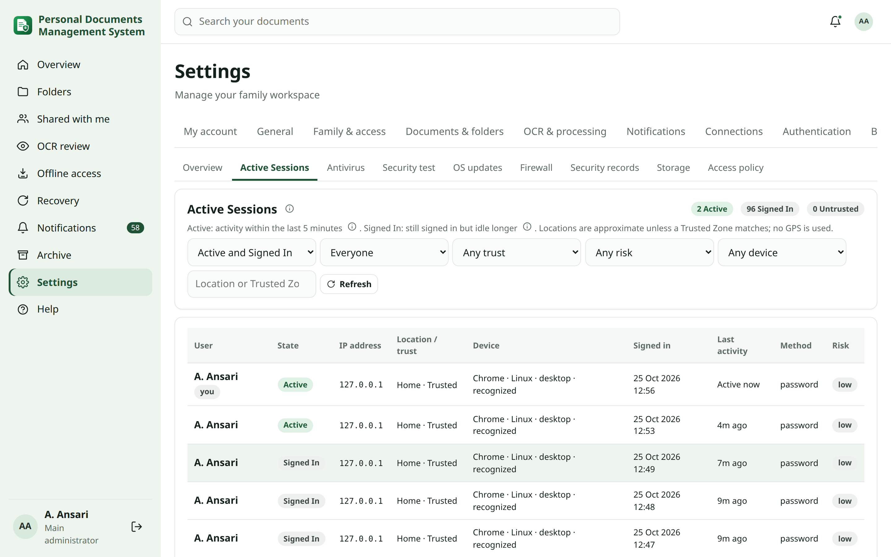
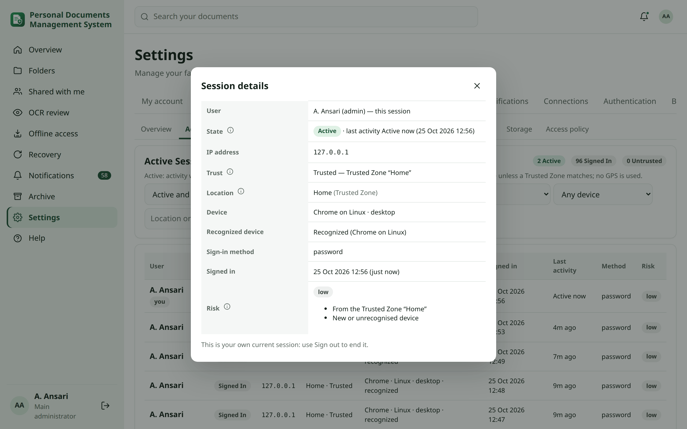
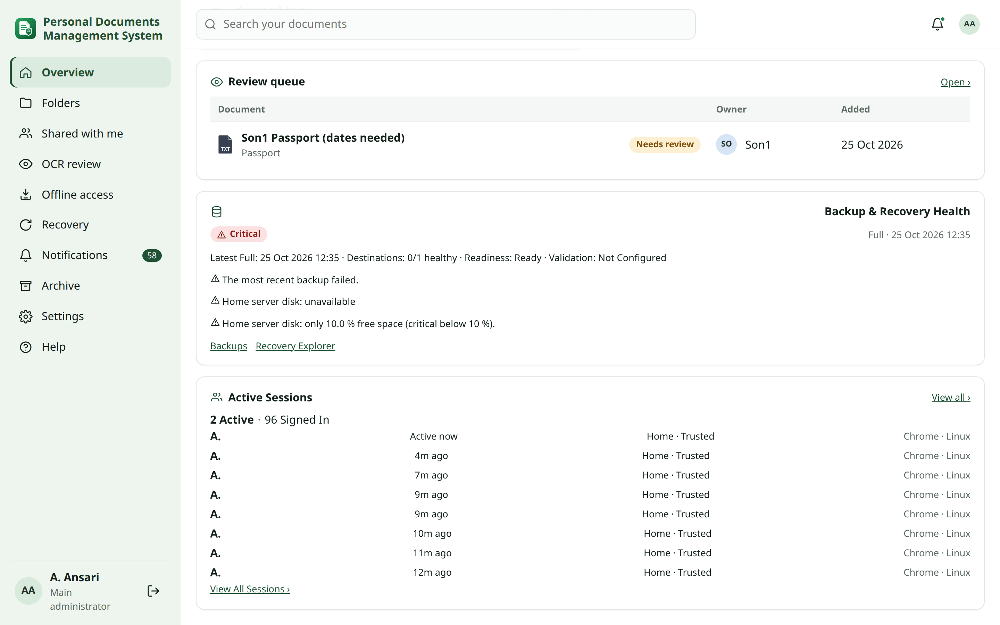

<!-- audience: admin -->
<!-- reviewed: 2026-10-25 -->
# Active Sessions

**Settings → Security → Active Sessions** shows every valid sign-in you are allowed to see — who, whether they are
active right now, from where, on which device and how risky it looks — and lets the main administrator end one
session. The **Active Sessions** tile on the Overview summarises it. Family members see their own sessions in
**My account → Sessions** ([Sessions](totp-recovery.md#sessions)).

## Active and Signed In {#active-threshold}

- **Active** — the session made a request the person caused (opening a page, searching, uploading …) within the
  Active threshold.
- **Signed In** — the session is still valid, but idle for longer than that.

Set the threshold in **Settings → Security → Active Sessions → Sessions → Consider session Active when activity
occurred within: [5] minutes** (2–120 minutes). Activity is recorded with the requests people already make, at most
every minute or two — there is no per-second heartbeat. Background refreshes (notification polling, offline sync,
progress polling) keep a session alive without making it Active.

## Who sees what {#visibility}

- The **main administrator** sees all family sessions, with complete IP addresses (the same policy as the sign-in
  records).
- An **Administrator** (scoped) sees their own sessions and those of the members delegated to them.
- **Family members** do not see this page; they see their own devices in My account.

Session cookies, session keys and tokens are never shown anywhere.

## Location and trust {#location-and-trust}

The place of a session is resolved from its current address, in this order:

1. **Trusted Zone** — a network you named in [Sign-in map & Trusted Zones](security-map.md#trusted-zones), shown by
   its name (for example *Home*) and as *Trusted*;
2. **Private network** — an internal address that matches no zone;
3. **GeoIP** — the local GeoIP database gives a country or city, always labelled **Approximate**. It is never a street
   address, and no remote lookup is made.

The browser is never asked for its position (no GPS). A session outside a Trusted Zone on a public network counts as
**Untrusted** in the counts. Being in a Trusted Zone is one signal only, not proof that a session is safe.

## Risk {#risk}

Risk comes from the sign-in risk classification (new country, unusual travel, new device …) and is raised when the
session's address moved to a public network after the sign-in, or to **high** when its device was marked
Unrecognized. The main administrator is notified once about a high-risk session that is still valid.

## Filters and details {#filters}

Filter by Active/Signed In, user, trust, risk, device type and location or Trusted Zone. Open a session for its
details: complete IP address, trust and Trusted Zone, approximate location, browser, operating system, device type,
recognized-device status, sign-in method, sign-in time, last activity, session age and the risk reasons.

## Terminate Session {#terminate-session}

The main administrator can **Terminate Session** in the session details, after an explicit confirmation. The session
is ended on the server: its next request is refused and that browser must sign in again, whatever cookie it still
holds. The person's other sessions keep working. The person is notified, and the action is recorded in the audit log.
Your own current session cannot be terminated here — use Sign out.

Terminate Session is **not** Mark Unrecognized: the device stays recognized. Use
[Mark Unrecognized](security-map.md#devices) when a device itself should no longer be trusted — that ends all its
sessions and removes its recognition.

## The Overview tile {#tile}

The **Active Sessions** tile (administrators) shows, for example, *4 Active · 7 Signed In · 1 Untrusted* and the people
with the latest activity, with **View All Sessions**. It adapts to its size: **compact** shows the counts, **medium**
adds a few people with their last activity and place, **large** adds the device. Move it, resize it and put it in any
group with [Edit Layout](overview.md#edit-layout); your layout is yours alone and follows you to every device.
Upgrading adds the tile to your General group without changing your arrangement.
