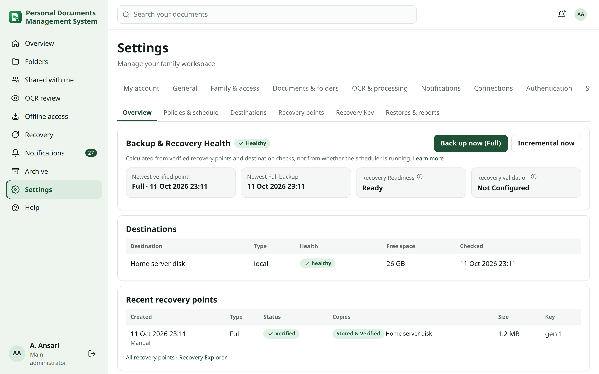
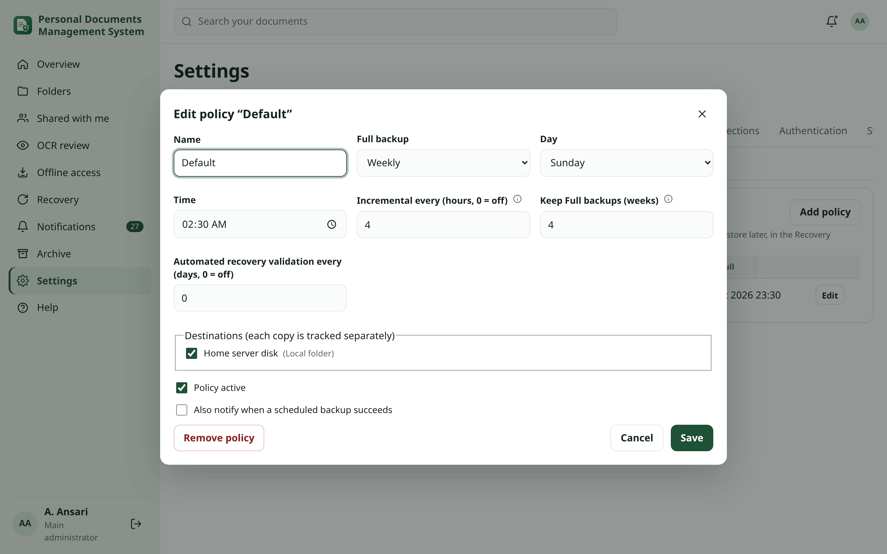
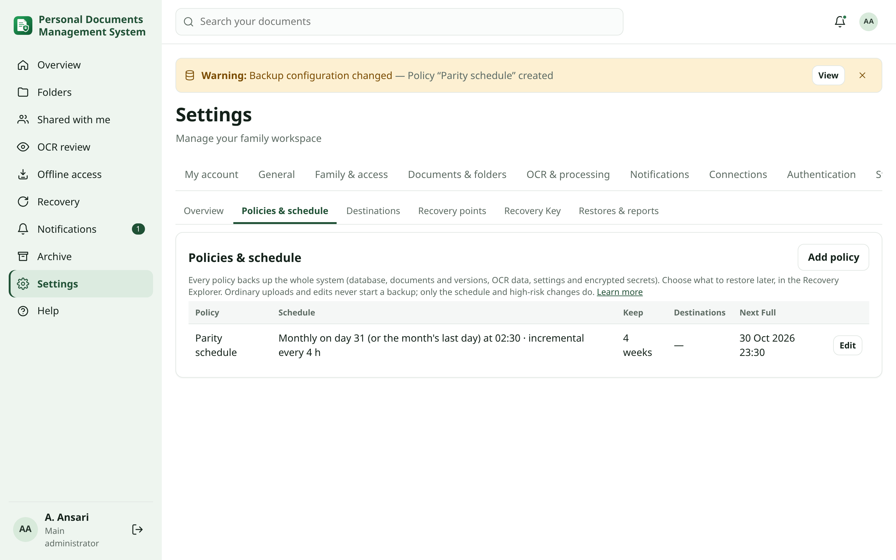
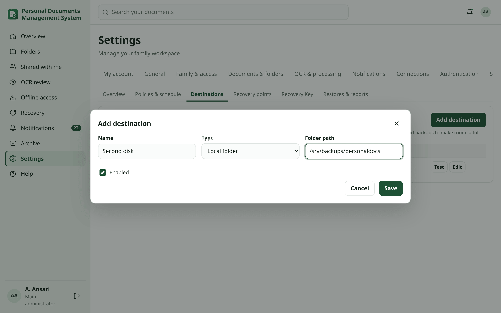
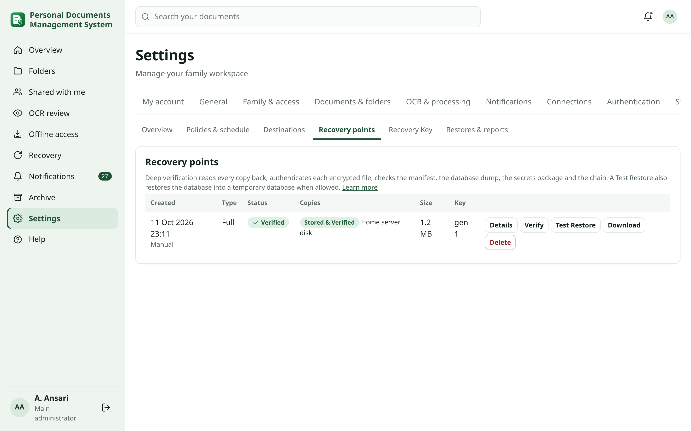
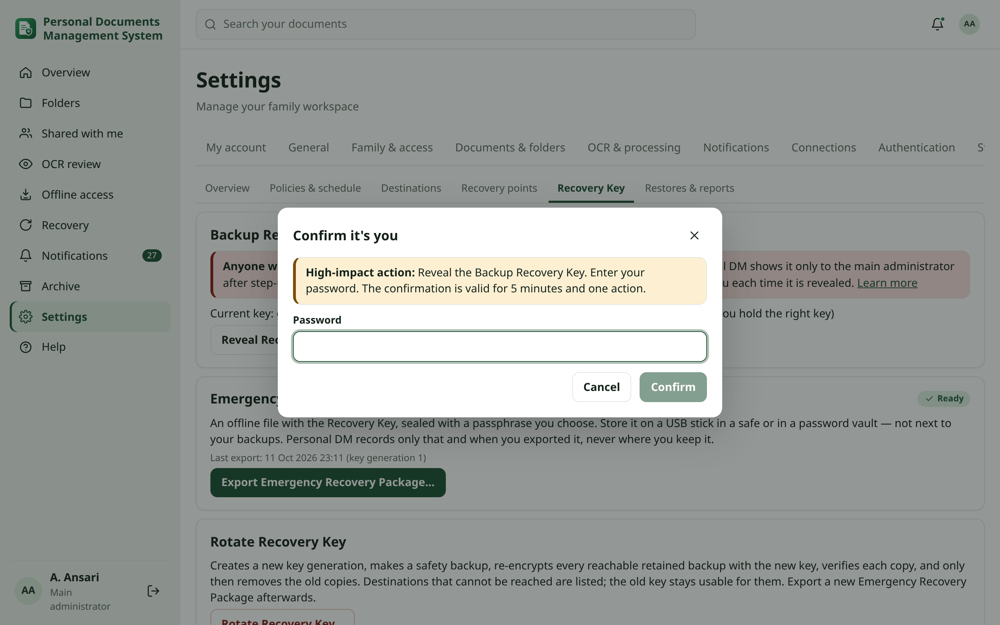
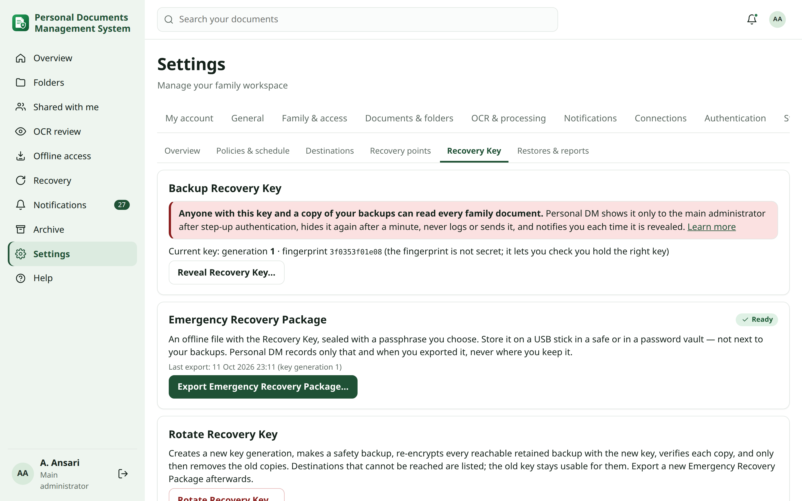
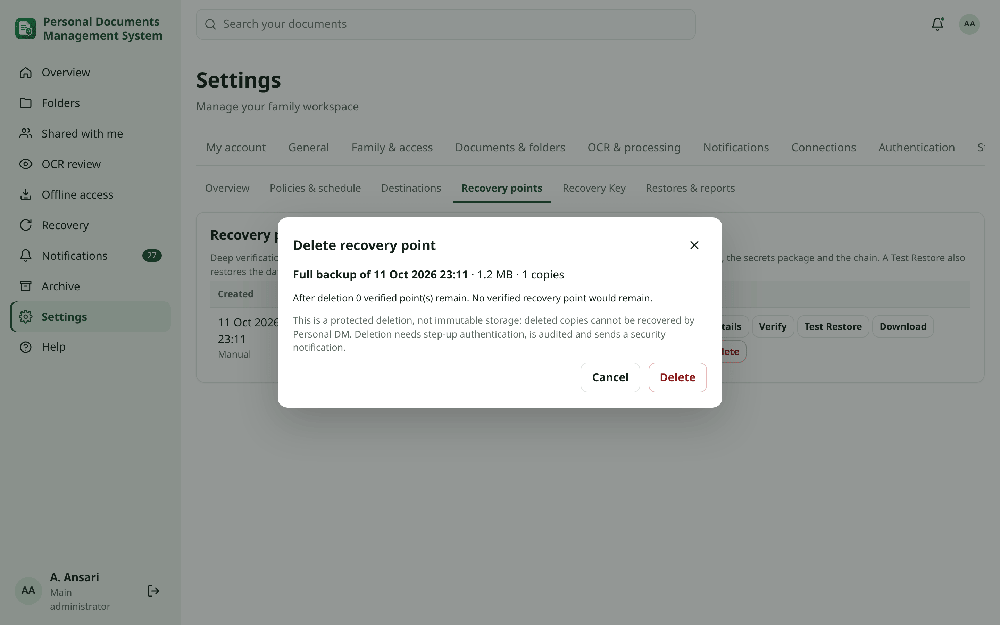
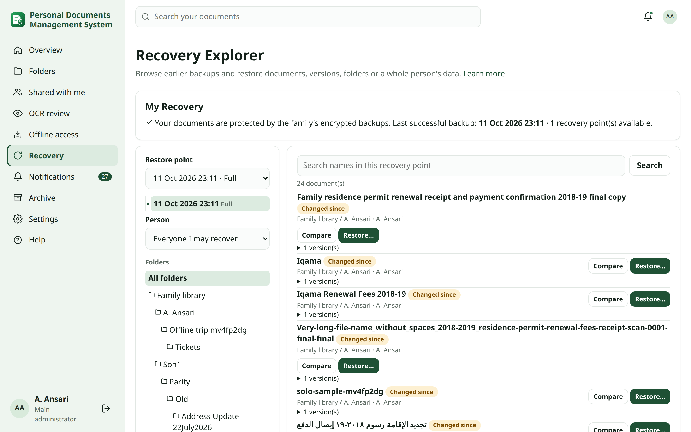
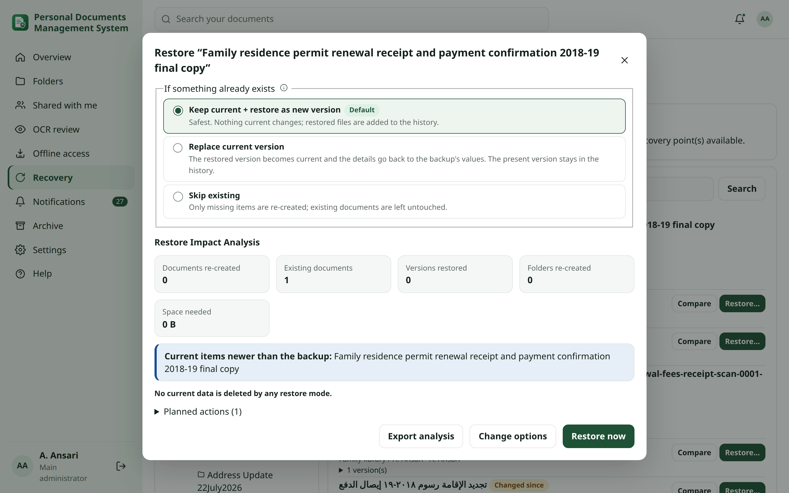

<!-- audience: admin -->
<!-- reviewed: 2026-10-11 -->
# Backup & Recovery

Personal DM backs up the **whole application**: database, documents and every version, OCR data, settings and the
encrypted secrets needed to run again. You choose what to restore later: one version, a document, a folder, a
person's data, or the whole system.

> [!NOTE]
> Personal DM restores the application onto a working Debian 13 server. Rebuilding the Proxmox host, the LXC
> container or the operating system is outside Personal DM. For a full rebuild, see the
> [disaster-recovery runbook](disaster-recovery.md).

**Who can do what**

| Person | Can do |
| --- | --- |
| Main administrator | Configure backups, see every recovery point, use the Recovery Key, download and delete backups, restore anything. |
| Everyone else, administrators included | See **My Recovery**, and restore only what they may access today (see [Recovery Explorer](#explorer)). |

## Quick start {#quick-start}

Prerequisites: you are the main administrator, and you have a place to store backups. This can be a mounted NAS share,
an S3 bucket, a Google Drive or OneDrive folder, or a local folder on another disk.

1. Open **Settings → Backup & Recovery → Destinations** and click **Add destination**.
2. Choose the type, enter the details (see [Destinations](#destinations)) and click **Save**.
3. Click **Test**. The health changes to **Healthy**.
4. Personal DM creates the recommended policy, named **Default**. It makes a Full backup every Sunday at 02:30 and an
   incremental backup every 4 hours, and keeps Full backups for 4 weeks.
5. Go back to **Overview** and click **Back up now (Full)**.
6. Open **Recovery Key** and click **Export Emergency Recovery Package…**. Keep the file offline (see
   [Emergency Recovery Package](#emergency-package)).

> [!IMPORTANT]
> **Expected result:** the Overview shows **Backup & Recovery Health: Healthy**, a verified Full recovery point, and
> **Recovery Readiness: Ready**.



## What a recovery point contains {#contents}

Every recovery point, Full or incremental, contains:

- **Database**: a complete snapshot of accounts, groups, delegations, folder and document permissions, documents and
  versions, metadata, document types, OCR text and positions, settings and per-person preferences, notification
  routing, quiet hours, Trusted Zones and their map pins, backup policies, the audit log and security records.
- **Documents**: the original file of every retained version. An incremental stores only new files and refers to
  unchanged files in earlier points of the same chain.
- **Previews, searchable PDFs, thumbnails**, profile photos and sign-in branding.
- **Secrets package**: the installation encryption key (which unlocks the SMTP, Telegram, Google, authentik, S3 and
  cloud credentials stored in the database), the Django secret key, and the WhatsApp Personal linked-device session
  files.
- **Manifest**: application and database version, chain, inventory, checksums and compatibility information.

Not included:

- the PaddleOCR runtime and models (`sudo personaldocs repair` reinstalls them);
- the GeoIP database file (download it again);
- files held in the antivirus quarantine.

> [!NOTE]
> **Privacy** Every file is encrypted before it leaves the server:
> - AES-256-GCM in 1 MiB authenticated chunks;
> - one data key per recovery point, wrapped with the Backup Recovery Key (HKDF-SHA256);
> - nothing is compressed first, so original files keep their exact form.
>
> A destination only ever holds ciphertext and a small header with no document names.

## Health and Overview {#health}

The **Backup & Recovery Health** badge is calculated from verified recovery points and destination checks. A running
scheduler alone never makes it Healthy.

| State | Meaning |
| --- | --- |
| **Healthy** | A recent recovery point is verified on every destination, and the Emergency Recovery Package is current. |
| **Attention** | Something needs action soon, for example: a destination failed while another holds a verified copy, the newest point is older than the schedule expects, the Emergency Recovery Package is missing or outdated, or a key rotation is incomplete. |
| **Critical** | There is no usable verified recovery point, no destination, or the newest verified point is far too old. |

The same badge appears in the **Backup & Recovery Health** widget on the Overview (main administrator). Everyone else
sees the **My Recovery** widget (see [My Recovery](#my-recovery)).

## Policies and schedule {#policies}

**Settings → Backup & Recovery → Policies & schedule**

Every policy backs up the full system. There are no partial backup policies, because a partial backup could leave out
something you need. You choose the scope when you restore.

| Field | Default | Notes |
| --- | --- | --- |
| Full backup | Weekly | Daily, weekly (choose the day) or monthly (choose the day of the month). |
| Time | 02:30 | Installation timezone. |
| Incremental every (hours) | 4 | 0 turns incrementals off. |
| Keep Full backups (weeks) | 4 | See [Retention](#retention). |
| Destinations | all | The same recovery point is copied to each destination, and each copy is tracked separately. |
| Automated recovery validation every (days) | 0 (off) | Needs an isolated environment (see [Automated Recovery Validation](#validation)). |
| Also notify when a scheduled backup succeeds | off | Failures are always notified. |



To edit a policy:

1. Click **Edit**.
2. Change the schedule.
3. Click **Save**.

The next Full backup is shown in the table.

Rules that always apply:

- **Normal activity never starts a backup.** Uploads, edits and permission changes are picked up by the next
  scheduled point.
- **Missed runs:** if the server was off at the scheduled time, the missed Full backup runs once when the scheduler is
  back. It never runs twice for the same slot.
- **Monthly on the 29th–31st** runs on the last day of shorter months.

### Schedule {#schedule}

Installations upgraded from the previous release keep their schedule. The old daily, weekly or monthly backup became
the Full schedule of the **Default** policy, and incrementals start switched off. To follow the recommendation, set
**Incremental every** to 4.

A monthly Full backup on day 29, 30 or 31 runs on the last day of shorter months. The table shows each policy's schedule
and its next Full backup:



### Safety backups before high-risk changes {#pre-update}

Some operations first make a safety backup and deep-verify it, then continue:

- application upgrades (`sudo personaldocs upgrade`);
- OS security updates started from Settings → Security;
- Recovery Key rotation.

If the safety backup cannot be verified, the operation is blocked and a critical notification is sent. Only the main
administrator can override it, explicitly, and the override is audited.

## Destinations {#destinations}

**Settings → Backup & Recovery → Destinations → Add destination**

| Type | What to enter |
| --- | --- |
| **Local folder** | An absolute folder on another disk or USB drive, e.g. `/srv/backups/personaldocs`. **Test** creates the folder. If it later disappears, the destination shows *Destination Unavailable*; it is never quietly re-created on the system disk. |
| **NAS share (NFS/SMB)** | The mounted folder, e.g. `/mnt/pdnas/personaldocs`. Mount it under Settings → Storage & NAS (see [Connecting the NAS](#nas)). The folder must contain the marker file `.personaldocs-backup-target`. |
| **S3-compatible storage** | The https endpoint, region, bucket and folder prefix, plus an access key and secret key that can only read and write that bucket. |
| **Google Drive** | A folder id and your own OAuth client id, client secret and refresh token (scope `drive.file`). See [Google Drive](#gdrive). |
| **Microsoft OneDrive** | A folder (default `Apps/PersonalDocs`) and your own OAuth client id, client secret and refresh token (`Files.ReadWrite offline_access`). See [OneDrive](#onedrive). |



Credentials are stored encrypted. The page only shows that they are stored; it never shows their values. Click
**Test** after each change.

### Copy states {#copy-states}

| State | Meaning and what to do |
| --- | --- |
| **Stored & Verified** | The copy was read back and deep-verified. |
| **Stored, Verification Warning** | Readable, but something needs a look; open **Details**. |
| **Retry Pending** | The destination was unavailable. Personal DM retries from the local staging copy for 24 hours without making a new backup. |
| **Destination Unavailable** | Mount the share or fix the network, then click **Test**. |
| **Authentication Required** | The credentials were rejected or expired. Enter them again under **Edit**. |
| **Insufficient Storage** | The destination is full. Free space there or add a destination. Personal DM never deletes valid backups to make room. |
| **Failed** | Open **Details** for the exact check that failed. |

If one destination fails and another holds a verified copy, the recovery point is **Partially protected** and the
health is **Attention**.

### Google Drive {#gdrive}

1. In Google Cloud Console, create an OAuth client of type *Desktop app* and enable the Google Drive API.
2. Get a refresh token with the scope `https://www.googleapis.com/auth/drive.file` (for example with the OAuth
   Playground, using your own client).
3. Create a folder in Drive and copy its id from the address bar.
4. Enter the folder id, client id, client secret and refresh token in **Add destination → Google Drive**, then click
   **Test**.

> [!WARNING]
> Live Google Drive and OneDrive transfers were not part of the automated test run: they need real accounts. The
> code is tested against recorded API behaviour. Run **Test** and a **Back up now** after setting them up, and look for
> **Stored & Verified**.

### OneDrive {#onedrive}

1. Register an app in Microsoft Entra ID with the delegated permissions `Files.ReadWrite` and `offline_access`.
2. Obtain a refresh token for your account.
3. Enter the client id, client secret and refresh token, and optionally a folder (default `Apps/PersonalDocs`).
4. Click **Test**.

### Connecting the NAS {#nas}

Set this up in **Settings → Storage & NAS → NAS connection**:

| Field | NFS example | SMB example |
|---|---|---|
| NAS connection | NFS | SMB |
| NAS server | `192.0.2.20` | `nas.example.lan` |
| Share / export | `/volume1/backups` | `backups` |
| Folder on the share | `personaldocs` | `personaldocs` |
| SMB username / password / domain | — | `backup-user` / password / optional |
| Protocol version | optional (`4.1`) | optional (`3.0`) |

1. Click **Save settings**, then **Connect NAS**.
2. A small system service mounts the share at `/mnt/pdnas`, creates the folder and checks that the app can write to it.
3. Add `/mnt/pdnas/personaldocs` as a **NAS share** destination.

**Disconnect** unmounts the share. The share is mounted again automatically after a reboot. The SMB password is stored
encrypted and is written only to a root-only credentials file.

#### Container requirements {#lxc-requirements}

Proxmox allows NFS/SMB mounts only inside **privileged** containers with the feature **mount=nfs;cifs**. For an
**unprivileged** container, mount the share on the Proxmox host and pass it in:

```
# on the Proxmox host
mount -t nfs 192.0.2.20:/volume1/backups /mnt/nas-backup
mkdir -p /mnt/nas-backup/personaldocs && chown 100000:100000 /mnt/nas-backup/personaldocs
pct set <id> -mp0 /mnt/nas-backup/personaldocs,mp=/mnt/nas-backup/personaldocs
```

Then, inside the container, create the marker file:

```
touch /mnt/nas-backup/personaldocs/.personaldocs-backup-target
```

Add the folder as a **NAS share** destination.

## Retention {#retention}

- Full backups are kept for **4 weeks** by default. You can change this per policy.
- Incrementals are kept with their Full backup. A chain (one Full and its incrementals) is removed as a unit, so a Full
  backup is never deleted while an incremental still depends on it.
- The newest usable chain is always kept, even when it is older than the retention period.
- Cleanup runs automatically after scheduled backups. It is audited, and you get a notification.
- A copy on an unreachable destination is marked *deletion pending* and removed when the destination is back.

### Legacy folder backups {#legacy}

Unencrypted folder backups made before this release (`backup-YYYYMMDD-…`) are listed read-only on the Overview. They are
never deleted automatically, and they can still be restored from the console:

```
sudo personaldocs restore /mnt/nas-backup/personaldocs/backup-20261003-023000-personaldocs --verify-only
```

Delete them yourself once you have verified encrypted recovery points. The old settings are under
**Settings → Storage & NAS → Legacy folder backups**.

### Identity {#identity}

The installation identity (Settings → General) is recorded in every manifest and in legacy folder names.

### Target (legacy setting) {#target}

**Legacy backup folder** (`backup.target`) is the folder of the old format. On upgrade it became the destination
*Existing backup share*.

## Deep verification {#verification}

After every backup, each copy is read back from its destination and checked:

1. the header and the key generation;
2. the checksum of every encrypted file, and that it decrypts and authenticates (no plain text is stored);
3. the manifest and every recovery class;
4. the document and version inventory against the catalogue;
5. the database dump structure (`pg_restore --list`);
6. that the settings package and the encrypted secrets package can be read, including the installation key;
7. that the earlier points this incremental depends on are present on the same destination.

The result is **Verified**, **Warning** or **Failed**. Open **Recovery points → Details** to see each check. Click
**Verify** to run it again at any time.



### Test Restore {#test-restore}

**Recovery points → Test Restore** decrypts and authenticates every component of the point and its chain. Then:

- If the database account may create databases, it restores the dump into a temporary database and compares the
  number of users, permissions, folders, documents and versions with the catalogue.
- Otherwise it checks the dump structure and says so (*structure-only*).

It never touches the live installation. The result is listed under **Restores & reports**.

### Automated Recovery Validation {#validation}

Optional. You prepare an isolated environment yourself; Personal DM does not create or manage it. The environment needs:

- a separate PostgreSQL database (ideally on another host);
- an empty folder.

Then set it up:

1. Enter the database address and the folder in **Settings → Storage & NAS** (*Recovery validation database*,
   *Recovery validation folder*).
2. Set **Automated recovery validation every (days)** in a policy.

Personal DM then periodically restores the newest verified point there and checks the database, users and permissions,
folders, documents, versions, settings, readable secrets, OCR metadata and an application start. Notifications and
integrations are switched off during the check (sandbox mode).

Until this is configured, the Overview shows **Recovery Validation: Not Configured**. Deep verification is never shown
as an end-to-end restore.

## Backup Recovery Key {#recovery-key}

One **Backup Recovery Key** protects all retained backups of its generation. It is created with the first encrypted
backup and stored on the server only in encrypted form.

> [!CAUTION]
> Anyone who has this key and a copy of your backups can read every family document. Never store the key next to the
> backups, in email, or in chat.

To see the key:

1. Open **Settings → Backup & Recovery → Recovery Key** and click **Reveal Recovery Key…**.
2. Enter your password. If you have an authenticator app, also enter its code. If you have a passkey, click
   **Confirm with passkey** instead of entering a code. This step-up confirmation is valid for one action within
   5 minutes.
3. The key (`PDRK1-…`) is shown and hides itself after 60 seconds. **Copy** clears the clipboard after 30 seconds.



Each reveal is audited (without the key) and sends a critical security notification to the main administrator. The
**fingerprint** shown on the page is not secret. Use it to check that you are holding the right key.

### Emergency Recovery Package {#emergency-package}

An offline file (`.pdrp`) that contains the Recovery Key, sealed with a passphrase you choose (scrypt + AES-256-GCM),
plus short recovery instructions.

1. Click **Export Emergency Recovery Package…**.
2. Enter a passphrase of at least 12 characters twice.
3. Click **Export** and confirm with step-up.
4. Move the file to a USB stick in a safe or to a password vault. Write the passphrase down separately.



> [!NOTE]
> **Privacy** Personal DM records only **that** a package was exported, **when**, and for **which key generation**. It
> never records where you keep it. The package is never saved next to backups or uploaded to a destination.

**Recovery Readiness** shows:

- **Not Ready**: no package has been exported;
- **Ready**: the package matches the current key;
- **Outdated**: the key was rotated after the last export.

### Rotating the Recovery Key {#rotation}

Use **Rotate Recovery Key…** when the key may have been exposed, or on a regular schedule.

1. Personal DM makes a safety backup with the current key.
2. It creates a new key generation and re-encrypts every reachable retained recovery point with a new data key.
3. It copies each re-encrypted package to every destination that holds the point and deep-verifies it.
4. Only then does it delete that destination's copy under the old key.
5. Destinations that cannot be reached are listed by name, and the rotation is recorded as **Partial**. The old key
   stays usable for them until you click **Retry rotation** (it is destroyed only when no retained copy needs it).
6. Export a new Emergency Recovery Package: the old one is now **Outdated**.

Rotation is audited and notified.

## Downloading a backup {#download}

**Recovery points → Download** (main administrator, step-up) streams an uncompressed `.tar` of the **complete
recoverable set**: the base Full backup and the incrementals up to that point, with a `README.txt`. Only ciphertext
leaves the server. Every download is audited and notified. Knowing the address is not enough to download: the request
must come from the signed-in main administrator who just completed step-up.

To restore from a download on a new server, extract it and use `sudo personaldocs recover` (source *Local folder*), or
give the `.tar` file directly (source *Downloaded package file*).

## Deleting a backup {#deletion}

**Recovery points → Delete** is a protected action:

1. The dialog shows the point and its copies, the later points that depend on it, and how much restore history you
   would lose.
2. A point with dependants can only be deleted together with them. Tick the box to confirm.
3. Click **Delete** and confirm with step-up. The deletion is audited and sends a critical security notification.



> [!WARNING]
> This is a protected deletion, **not** immutable storage. Deleted copies cannot be brought back by Personal DM. For
> protection against ransomware on the destination itself, use the destination's own snapshot or object-lock features.

## Recovery Explorer {#explorer}

**Recovery** in the sidebar opens the Recovery Explorer for everyone. On it you can:

- pick a restore point from the list or the timeline (Full points have a filled dot);
- browse **Person → Folders → Documents → Versions** (the main administrator sees every person);
- search names in that recovery point;
- **Compare** a document in the backup with today's version (title, dates, number of versions, details).



What each person sees follows **today's** permissions:

- **Main administrator:** everything.
- **Everyone else, administrators included:** documents they owned in the backup, documents where they can add versions
  today, and documents whose folder still exists and where they can upload today. The Administrator role never grants
  document access by itself.

Deleted data can be recovered only while a retained backup still contains it. There is no hidden extra "deleted items"
store.

### Restoring a version, document, folder or person {#restore}

1. Choose **Restore version…**, **Restore…** (document), **Restore this folder…** or, as main administrator,
   **Restore this person's data…**.
2. Choose what happens if something already exists (see [Conflict choices](#conflicts)).
3. Click **Analyse impact** and read the [Restore Impact Analysis](#impact).
4. Click **Restore now**.

> [!IMPORTANT]
> **Expected result:** **Restore completed**. Restored versions carry the comment "Restored from backup of …". The
> restore is audited, and you and the main administrator get a notification.

### Conflict choices {#conflicts}

| Choice | What happens |
| --- | --- |
| **Keep current + restore as new version** (default, safest) | Current data stays as it is. Restored files are added to the version history; missing documents and folders are re-created. |
| **Replace current version** | The restored version becomes the current version again, and the document details return to the backup's values. The present version stays in the history. |
| **Skip existing** | Existing documents are left alone. Only missing items are re-created. |

No choice ever deletes current data.

### Restore Impact Analysis {#impact}

Before anything changes, the analysis shows:

- the restore point, the target and the mode;
- how many documents and folders will be re-created, and how many versions restored;
- conflicts, and current items that changed after the backup;
- permission differences. Current permissions are kept; the backup's rules are only applied to re-created items;
- the disk space needed compared with what is free;
- every planned action, and what will become current again in *Replace* mode;
- *No current data is deleted by any restore mode.*

Click **Export analysis** to keep a JSON copy.



### Data of a deleted account {#deleted-user}

When the backup contains a person whose account no longer exists, the main administrator chooses one of these:

- **Re-create the account**: same username and display name; a new password is required. Old sessions, passkeys and
  two-step settings are **not** brought back.
- **Restore into another person's library**: into a folder *Recovered from <name> (<date>)*.
- **Recovery staging area**: a folder *Recovery staging* that only the main administrator can see.

## My Recovery {#my-recovery}

Everyone sees the **My Recovery** card on the Recovery page and as an Overview widget. It shows:

- whether your documents are protected;
- the last successful backup;
- how many recovery points are available.

It never shows destinations, credentials, other people or administrative settings.

## Command line {#cli}

| Command | What it does |
| --- | --- |
| `sudo personaldocs backup` | Full encrypted recovery point now. Use `--incremental` for an incremental. |
| `sudo personaldocs backup list` | Recovery points and their copies, plus legacy folder backups. |
| `sudo personaldocs backup health` | Backup & Recovery Health, readiness and validation. Never prints secrets. |
| `sudo personaldocs backup verify <point id>` | Deep verification of every copy. |
| `sudo personaldocs recover` | Disaster recovery (see the [runbook](disaster-recovery.md)). |
| `sudo personaldocs doctor` | Also reports backup age and status, chain integrity, destinations, readiness and validation. |

## Integrity check {#integrity}

Runs nightly (without checksums) and on demand (with checksums) from Settings → Storage & NAS, or with
`personaldocs integrity`. It reports missing or changed originals, broken version references and orphaned files.

Repairs never delete anything:

- missing previews are requeued;
- unknown files are moved to `/var/lib/personaldocs/quarantine`.

A missing original can only come back from a backup. Use the Recovery Explorer.

## Encryption key of the installation {#keys}

SMTP, Telegram, Google, mailbox, S3 and cloud passwords are encrypted with `/etc/personaldocs/encryption.key`. The
encrypted secrets package of every recovery point contains this key, so a restored installation can read them again.
The old option *Include encryption key in backup* only affects legacy folder backups.

## Proxmox snapshots {#snapshots}

LXC snapshots are a useful extra layer, but they are not a verified application backup. Take one on the Proxmox host
before large changes if you want a fast full rollback.

## Troubleshooting {#troubleshooting}

| Symptom | Cause and fix |
| --- | --- |
| **Destination Unavailable** | The share is not mounted, the marker file is missing, or the network is down. Mount it, check `ls /mnt/pdnas/personaldocs/.personaldocs-backup-target`, then click **Test**. The copy is retried automatically for 24 hours. |
| **Insufficient Storage** | Free space on the destination or add another destination. Shorten **Keep Full backups** only if that matches your plans. Personal DM never deletes valid backups to make room. |
| **Authentication Required** | S3 keys or OAuth refresh tokens expired or were revoked. Click **Edit**, enter new credentials, then **Test**. |
| **Partially protected** | One destination holds a verified copy and another failed. Fix the failed one; the next backup or the retry protects it again. |
| **Verification Failed** | Open **Details**. *checksum mismatch* or *authentication failed* means the destination returned changed data: check the storage, then run **Verify** again or make a new Full backup. |
| **High-risk operation blocked** | The safety backup could not be verified. Fix the backup first. Override only if you have another verified backup. |
| **Rotation Partial** | Bring the listed destinations back and click **Retry rotation**. |
| **"Another backup or key rotation is running"** | Wait for it to finish. Only one runs at a time to protect interactive use. |
