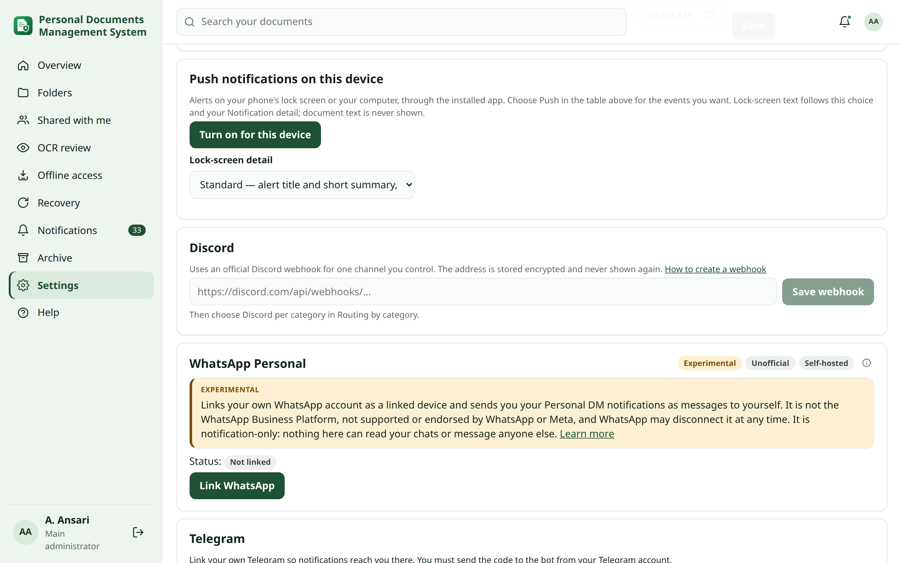

<!-- reviewed: 2026-10-12 -->
# Discord notifications

Personal DM can post your own notifications to a Discord channel that you control. It uses an **official Discord
webhook**. Each person adds their own webhook; the administrator only allows the feature.

## Allow Discord (administrator) {#setup}

1. Open **Settings → Connections**. The **Discord** provider card shows **Disabled by Admin**.
2. In the **Discord** section, turn on **Discord webhooks** and click **Save settings**.

**Expected result:** the card shows **Enabled** and how many people have connected a webhook (for example
*1/2 connected*). It never shows anyone's webhook address.

Turning it off stops Discord delivery for everyone. Saved webhooks are kept. While it is off, each person's Discord card
says **Disabled by Admin** instead of offering a webhook field.

## Add your webhook {#webhook}

Prerequisites: a Discord server where you may manage webhooks, ideally a private channel only you can read.

1. In Discord: **Server settings → Integrations → Webhooks → New webhook**. Choose the channel and click
   **Copy webhook URL**.
2. In Personal DM: **My account → Notifications → Discord**. Paste the address and click **Save webhook**.
3. Click **Send test**. A message titled "🧪 Test notification" appears in your channel.
4. In **Routing by category**, tick **Discord** for the categories you want (see
   [routing](notifications.md#routing)).

> [!IMPORTANT]
> **Expected result:** the card shows **Connected** and a short hint such as `webhook …5678`. The full address is
> never shown again.

> [!NOTE]
> **Privacy** The webhook address contains a secret token, so it is stored encrypted and never appears in logs,
> audits or diagnostics. Messages contain the same masked details as email or Telegram. They never contain attachments,
> document text or mentions (`@everyone` is disabled). Anyone who can read the Discord channel can read your
> notifications, so use a private channel.

## Manage it {#manage}

- **Enabled:** pause or resume Discord delivery without removing the webhook.
- **Last test / last delivery:** the card shows when the last test was sent and when a notification was last delivered.
- **Rotate the webhook:** in Discord, delete the old webhook and create a new one; in Personal DM click **Remove**, then
  save the new address.
- **Remove:** deletes the stored webhook.
- **Deleted in Discord:** if you delete the webhook in Discord, the next delivery shows **Deleted in Discord** and the
  channel counts as disconnected. Your fallback chain, if any, takes over. Add a new webhook to continue.

## Troubleshooting {#troubleshooting}

| Message | Fix |
| --- | --- |
| "Paste a Discord webhook address…" | Only `https://discord.com/api/webhooks/…` addresses (or the `discordapp.com`, `ptb` and `canary` variants) are accepted. |
| "Discord rate limit; will retry" | Discord asked to slow down. Delivery is retried automatically. |
| "Discord is turned off by the administrator" | Ask the main administrator to turn on **Discord webhooks**. |
