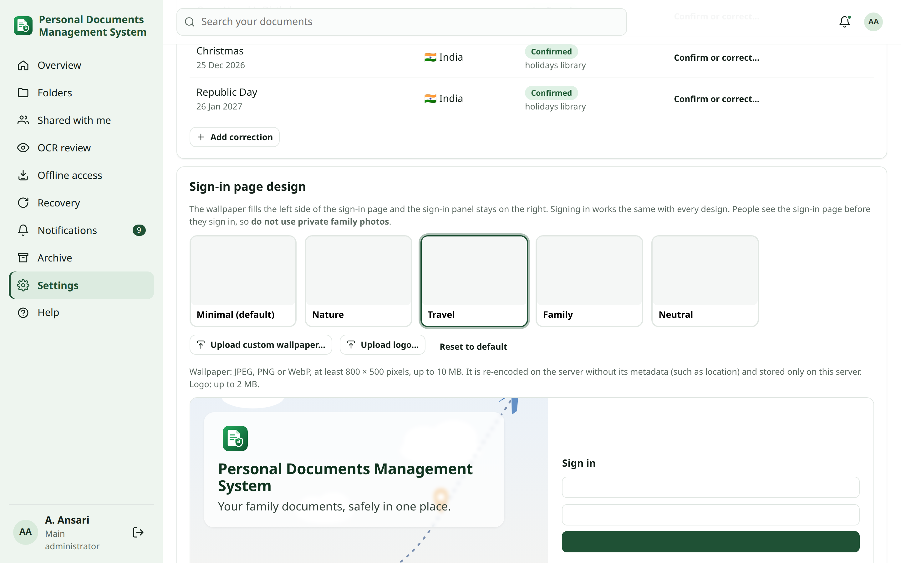

<!-- audience: main_admin -->
<!-- reviewed: 2026-10-12 -->
# Sign-in page designs

The sign-in page shows a light wallpaper on the left and the sign-in panel on the right. On phones the wallpaper becomes a short banner above the form, so signing in always comes first. The administrator changes the design in **Settings → Overview & sign-in**. Signing in works exactly the same with every design: password, authenticator codes (TOTP), passkeys and linked Google sign-in are offered according to the authentication settings, never according to the design.

## Preset designs {#presets}

| Design | Look |
| --- | --- |
| **Minimal** (default) | Soft theme-coloured shapes and folders |
| **Nature** | Light sky, hills and trees |
| **Travel** | Clouds, a flight path and a passport |
| **Family** | A house and simple, non-identifiable figures |
| **Neutral** | Light grey paper with document cards |

The presets are drawings bundled with the application; no image is loaded from the internet.

## Choose, preview and save {#choose}

1. Open **Settings → Overview & sign-in → Sign-in page design**.
2. Click a design. It is **previewed, not saved**: the **Live sign-in preview** shows the wallpaper, your title and logo,
   and the sign-in panel with its usual fields. The design in use is marked **In use**.
3. Switch between **Desktop** and **Phone** to see both layouts. On phones the wallpaper becomes a short banner above
   the form.
4. Click **Preview Sign-in Page** for a large preview.
5. Click **Save design** to publish it, or **Discard** to keep the current design.

**Expected result:** after saving, the sign-in page shows the new design to everyone who is not signed in.

### Your app theme does not change the sign-in page {#theme-independence}

The sign-in page always uses the default (green) theme. Your own app theme (Dark, Glass, Blue…) is a preference you
have after signing in, and it is not applied to the page people see before they sign in. The thumbnails and previews
use the sign-in theme too, so they look the same whichever theme you use:

- Changing your app theme never changes the saved sign-in design.
- Saving a sign-in design never changes anyone's app theme.

## Custom wallpaper {#custom}

**Upload custom wallpaper…** shows a preview first; choose **Use this wallpaper** to save it.

- JPEG, PNG or WebP, at least 800 × 500 pixels and at most 10 MB. Other files (PDF, SVG, GIF, renamed files) are rejected.
- The image is decoded and re-encoded on the server as WebP (at most 2400 pixels wide), which removes metadata such as camera details and GPS location. It is stored only on this server, under the data directory, and included in backups.
- **Wallpaper position** chooses which part stays visible when the picture is cropped to the screen (centre, top, bottom, left or right).
- **Wallpaper overlay** lightens the picture (0–80 %) so the title stays readable.
- **Remove custom wallpaper** deletes the file; if it was in use, the sign-in page returns to Minimal. **Reset to default** restores the Minimal design and the default texts.

The sign-in page is visible before anyone signs in, so **do not use private family photos** or pictures that show documents.

## Title, logo and tagline {#branding}

- **Sign-in title** — default "Personal Documents Management System".
- **Tagline** — a short line under the title; leave it empty to hide it.
- **Logo** — optional, JPEG/PNG/WebP up to 2 MB; transparency is kept. **Remove logo** returns to the standard shield icon.
