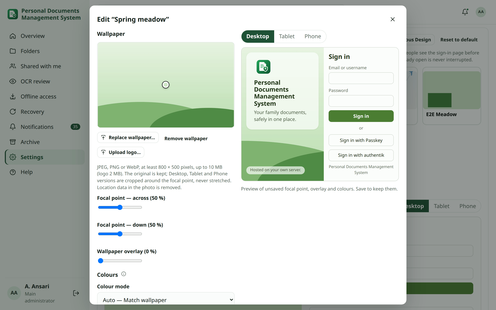

<!-- audience: main_admin -->
<!-- reviewed: 2026-10-15 -->
# Sign-in page designs

The sign-in page shows a light wallpaper on the left and the sign-in panel on the right. On phones the wallpaper becomes a short banner above the form, so signing in always comes first. The main administrator manages designs in **Settings → Overview & sign-in → Sign-in page design**. Signing in works exactly the same with every design: password, authenticator codes (TOTP), passkeys and linked Google sign-in are offered according to the authentication settings, never according to the design.

## Built-in designs {#presets}

| Design | Look |
| --- | --- |
| **Minimal** (default) | Soft theme-coloured shapes and folders |
| **Nature** | Light sky, hills and trees |
| **Travel** | Clouds, a flight path and a passport |
| **Family** | A house and simple, non-identifiable figures |
| **Neutral** | Light grey paper with document cards |

The built-in designs are drawings bundled with the application; no image is loaded from the internet. They are
**protected templates**: you can make one active or duplicate it (**Create from template**), but not edit or delete
it. **Minimal** is the protected default and always exists; **Reset to default** makes it active.

## Named designs {#designs}

You can keep as many designs as you like; only the server's storage and the image limits below set a limit. Exactly
**one** design is active for everyone: the sign-in page is the same for every visitor.

Each custom design keeps its own:

- name;
- wallpaper (the original, plus Desktop, Tablet and Phone versions made on the server);
- optional logo (otherwise the shared logo below is used);
- focal point and overlay;
- colour mode (Auto, Light, Dark or Custom) and the resulting palette.

### Create a design {#create}

1. Open **Settings → Overview & sign-in → Sign-in page design**.
2. Click **New design**, enter a name and choose the built-in artwork to start from.
3. The editor opens: upload a wallpaper (see [Wallpaper and focal point](#wallpaper)), adjust the colours, and click
   **Save design**.

To start from an existing design, select it and click **Duplicate** (for a built-in design: **Create from template**).
The copy shares the original's files, so it uses no extra space until you change its wallpaper.

**Rename** changes only the name. **Edit** is available for custom designs.

## Wallpaper and focal point {#wallpaper}

- JPEG, PNG or WebP, at least 800 × 500 pixels and at most 10 MB. Other files (PDF, SVG, GIF, renamed files) are
  rejected after reading their content, not only their name.
- The original is kept (up to 4000 pixels). Personal DM makes **Desktop**, **Tablet** and **Phone** versions, each
  cropped to the shape of the area it fills. Pictures are never stretched or squashed.
- The images are re-encoded as WebP on the server, which removes metadata such as camera details and GPS location.
  They are stored only on this server and included in backups.
- **Focal point:** click the part of the picture that must stay visible, or use the two sliders. Every crop keeps that
  point in view, and the preview follows it at once. **Save design** keeps it.
- **Wallpaper overlay** lightens the picture (0–80 %) so the title stays readable.

The sign-in page is visible before anyone signs in, so **do not use private family photos** or pictures that show
documents.

## Colours {#colours}

| Colour mode | What it does |
| --- | --- |
| **Auto — Match wallpaper** (default) | Reads the wallpaper, especially the part next to the sign-in panel, and picks a light or dark panel with matching button, field, border and link colours |
| **Light** / **Dark** | Forces a light or dark panel; the accent colour still comes from the wallpaper |
| **Custom** | Your own colours for each part of the panel; replacing the wallpaper keeps them |

Readability comes first. Text, buttons and links are adjusted until they meet the WCAG contrast ratios (4.5:1 for
text). For example, a pale green wallpaper gives a soft green-white panel with dark green buttons; a dark wallpaper
gives a dark panel. The editor shows the generated palette and warns if a custom colour is hard to read.

A replaced wallpaper is analysed again; a design in **Custom** mode keeps your colours.

## Preview {#preview}

The **Live sign-in preview** and **Preview Sign-in Page** show the real sign-in layout for the selected design at
**Desktop**, **Tablet** and **Phone** size:

- the wallpaper crop and focal point;
- the logo;
- the panel colours, fields and primary button;
- **Sign in with Passkey**, and Google or authentik when they are enabled.

Previewing or editing a design that is not active never changes the sign-in page.

### Your app theme does not change the sign-in page {#theme-independence}

The sign-in page always uses the default (green) theme. Your own app theme (Dark, Glass, Blue…) is a preference you
have after signing in, and it is not applied to the page people see before they sign in. The thumbnails and previews
use the sign-in theme too, so they look the same whichever theme you use:

- Changing your app theme never changes the saved sign-in design.
- Saving a sign-in design never changes anyone's app theme.

## Activate, revert and delete {#activate}

- **Set as Active** publishes the selected design at once, for everyone. The change is recorded in the activity log.
- **Revert to Previous Design** brings back the design that was active before the last change.
- **Delete** removes a custom design. If it is the active design, the built-in default is activated first, so the
  sign-in page is never without a design.
- Files are removed only when no other saved design uses them. Built-in artwork is never removed.
- If the active design's wallpaper file is missing or damaged, the built-in default is shown instead. The design is
  marked **Needs attention** and the main administrator is notified; replace its wallpaper under **Edit**.

A sign-in page that is already open is never refreshed or interrupted: the new design appears the next time the page
is opened. People who are signed in are not affected.

## Automatic design rotation {#rotation}

Under **Automatic Design Rotation**:

1. Turn on **Rotate the sign-in design automatically**.
2. Add at least **two** designs to the **Rotation pool**. Only these designs are ever activated automatically.
3. Choose the **Mode**:
   - **Sequential** goes through the pool in the order shown, then starts again. Drag the rows, or use the arrows,
     to change the order.
   - **Random** picks a design from the pool and avoids showing the same one twice in a row.
4. Choose **Daily**, **Weekly** (a weekday) or **Monthly** (a day of the month), and a time.
5. Click **Save rotation**.

The card shows the **Rotation Status**, **Rotation Mode**, **Current Design**, **Last Rotation**, **Next Rotation**
and the installation timezone (**Settings → General**). All times are in that timezone.

### Schedule rules {#rotation-schedule}

- **Monthly on day 29, 30 or 31:** in a shorter month the rotation runs on that month's last day, and returns to your
  day in later months.
- **Choosing Set as Active by hand** does not turn rotation off. The next scheduled rotation continues as usual.
- **After the server was off**, missed rotations are not replayed one by one. Sequential mode works out which design
  should be active now; Random mode makes one new choice. The activity log records the missed interval.
- Routine rotations are recorded in the activity log only. You are notified only when something needs attention.

### Rotation Needs Attention {#rotation-attention}

| What happened | What Personal DM does |
| --- | --- |
| A pool design is unavailable (missing or damaged wallpaper) or was deleted | Skips it, continues with the next valid design, notifies the main administrator and records it |
| Fewer than two valid designs remain | Shows **Rotation Needs Attention** and does not rotate until the pool is repaired |
| No valid design remains | Shows the protected built-in default; your rotation settings are kept for repair |
| The rotation itself fails | The current design stays; the main administrator is notified |

### Preview Rotation {#rotation-preview}

**Preview Rotation** shows, without changing anything:

- the pool in its order, with **Previous** and **Next**;
- every design at Desktop, Tablet and Phone size;
- the schedule and the **Next Rotation**;
- warnings for designs that would be skipped.

In Random mode it says that the next design is chosen at the scheduled moment.

## Title, logo and tagline {#branding}

- **Sign-in title** — default "Personal Documents Management System".
- **Tagline** — a short line under the title; leave it empty to hide it.
- **Logo** — the shared logo (Settings → Overview & sign-in, or the old **Upload logo** button), JPEG/PNG/WebP up to
  2 MB, transparency kept. A design can have its own logo in **Edit**; without one, the shared logo or the standard
  shield icon is shown.

## Upgrading from a single custom wallpaper {#upgrade}

Upgrading turns the previous sign-in page into named designs automatically:

- the five built-in designs become protected templates;
- a custom wallpaper you had becomes a custom design named **Custom wallpaper**, with your overlay and position as its
  focal point;
- whatever was active stays active, so the sign-in page looks the same;
- nothing has to be uploaded again;
- running the upgrade twice creates nothing new.

The Desktop, Tablet and Phone versions and the colours are made the first time the design is shown.
