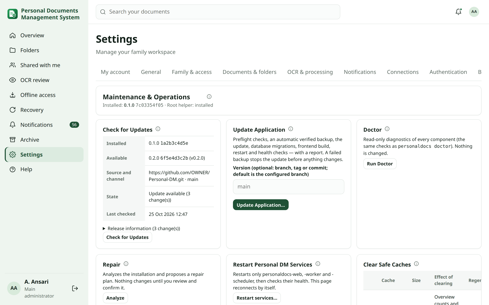
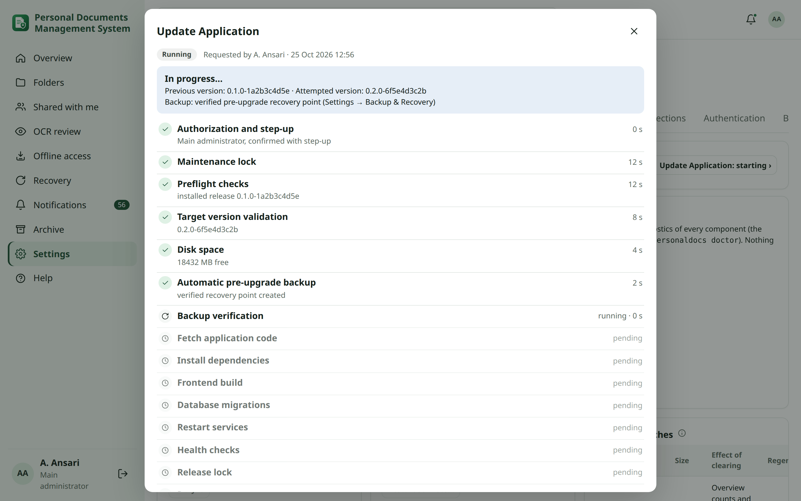
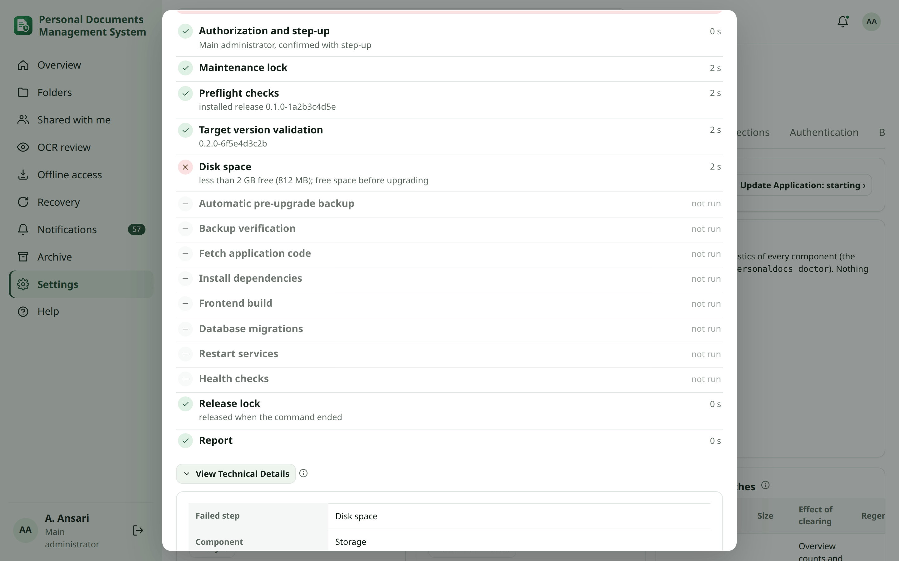
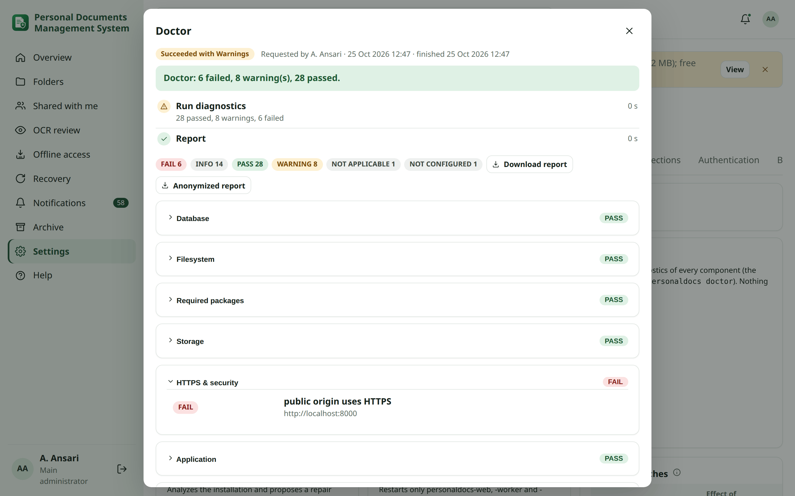
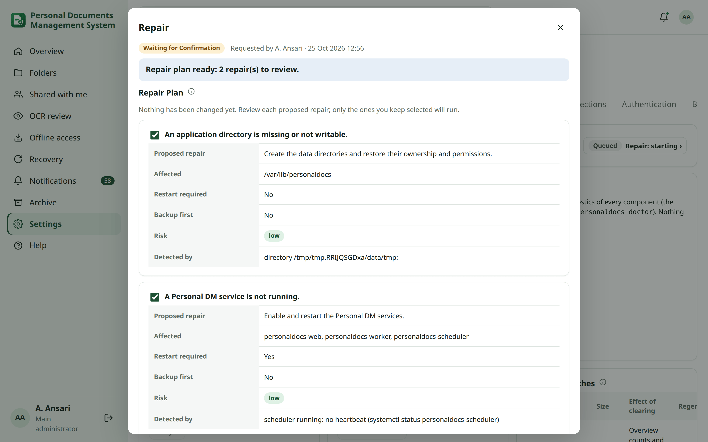
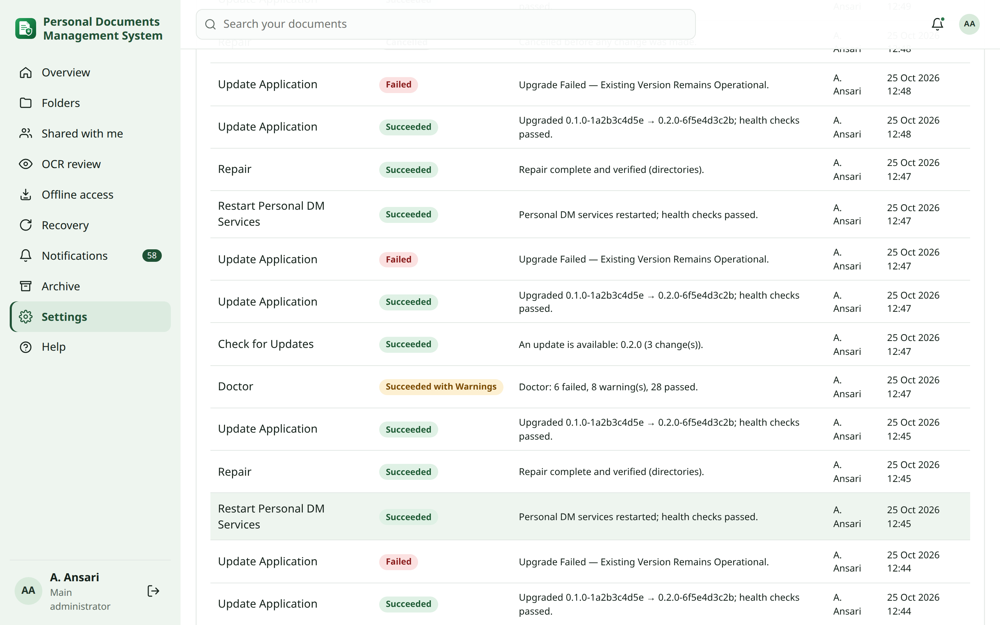

<!-- audience: admin -->
<!-- reviewed: 2026-10-25 -->
# Maintenance & Operations

**Settings → System → Maintenance & Operations** runs the everyday maintenance of Personal DM from the browser: check
for updates, update the application, Doctor, Repair, health, restarting the services, clearing safe caches, system
information and the history of every operation. The command line (`sudo personaldocs …`) keeps working exactly as
before and is the emergency path when the web interface is unavailable ([Upgrades](upgrades.md)).

## Who can do what {#permissions}

| | Main administrator | Administrator (scoped) | Family members |
|---|---|---|---|
| System Status and health panels | yes | read only | no |
| Doctor (read-only diagnostics) and its report | yes | yes | no |
| Job History (status and summaries) | yes | read only | no |
| Check for Updates, Update Application, Repair, Restart, Rollback, Clear Safe Caches | yes | no | no |
| Technical Details, Full Log, support reports, System Information | yes | no | no |

Update Application, Restart Personal DM Services, Rollback and confirming a Repair need a fresh **step-up**: your
password plus your authenticator code or passkey, valid for one action within 5 minutes. Every operation is recorded
in the audit log (without log contents).

There is no terminal or shell in the web interface. The page can only start the fixed operations described here; the
privileged ones are carried out by the root host helper, which runs one fixed `personaldocs` command per operation and
accepts only validated values (a branch/tag/commit name, repair items from a fixed list) — nothing typed in the browser
reaches a shell ([Security](security-center.md)).

## Maintenance Jobs {#maintenance-jobs}

Every operation becomes a **Maintenance Job** stored on the server with its ordered steps (each with start and end
time and status), the current step, a sanitized summary, technical details, a log, the exit code, the versions
involved, the backup reference, the recovery state and links to retries. Because the job lives on the server, it
survives a browser refresh, signing out and in again, closing the tab, and a restart of the application or its
services. Open it again from **Job History** or from the notification.

Statuses: **Queued**, **Running**, **Waiting for Confirmation** (a repair plan), **Succeeded**, **Succeeded with
Warnings**, **Partially Failed**, **Failed**, **Recovery Required**, **Rolled Back** and **Cancelled**.

While a job runs, the page polls its progress every few seconds and shows each step live. An upgrade or restart stops
the web service for a short time: the page shows *Reconnecting…* and continues by itself. A browser disconnect is never
a job failure — the root helper keeps working and the scheduler keeps the job up to date even when nobody is watching.

Upgrade, Repair, Rollback and Restart never run at the same time: the server allows one of them at a time (and the
command line keeps its own lock for terminal sessions). Doctor and Check for Updates may run alongside.

## Check for Updates {#check-for-updates}

Contacts the configured update source (the repository and branch from the installation, `PD_REPO_URL` /
`PD_BRANCH`) and shows the installed and the available version and revision, the source and channel, the changes
between them (release information), warnings that would stop an upgrade (for example less than 2 GB free, a pending
reboot) and when it was last checked. It never installs anything. An installation made from a local copy without a
repository shows *No update source configured*.

## Update Application {#update-application}

Choose **Update Application…**, optionally enter a branch, tag or commit (default: the configured branch), read the
steps, confirm and complete the step-up. The workflow:

1. authorization and step-up;
2. maintenance lock (no other upgrade, repair, rollback or restart; also no `personaldocs` command in a terminal);
3. preflight checks of the installation;
4. target version validation at the update source;
5. disk space (at least 2 GB free);
6. **automatic pre-upgrade backup** — a verified recovery point when a backup destination is configured, and always a
   local database snapshot;
7. backup verification — **a failed or unverifiable backup stops the upgrade before anything changes**;
8. fetch the application code;
9. install dependencies (Python environment);
10. frontend build (or the prebuilt frontend of a release);
11. database migrations;
12. restart the Personal DM services;
13. health checks (all services active and `/api/health` answering);
14. release the lock;
15. report (and a notification).

Your dashboard layouts, groups, tile sizes, settings and permissions are kept; new tiles (such as Active Sessions) are
added to your General group without changing anything you arranged ([Overview](overview.md#edit-layout)).

## When an upgrade fails {#upgrade-failure}

The result tells you exactly which situation you are in:

- **Upgrade Failed — Existing Version Remains Operational**: the failure happened before the database changed (for
  example the disk check, the backup, the download or the build), or a failed migration was undone from the snapshot
  and the previous version passed its health checks again. Nothing else to do but fix the cause and **Retry**.
- **Upgrade Failed — Rolled Back** (*Rolled Back*): the new version did not become healthy, the database was still
  compatible with the previous release, Personal DM switched back and the previous version **passed its health
  checks**. A rollback is only ever reported after that verification.
- **Upgrade Failed — Recovery Required**: the new version is not healthy and the database already has migrations the
  previous release does not know, so switching the code back would be unsafe and is not attempted. Follow
  [Recovery Required](#recovery-required).

Each result shows the previous and attempted version, the failed step, the backup reference, whether a rollback is
required, and the health state, with the actions **Copy Error**, **View Technical Details**, **View / Download Full
Log**, **Download Sanitized Support Report**, **Retry**, **Run Doctor**, **Repair**, **Rollback** (when applicable) and
**Recovery Guide**.

## Technical Details {#technical-details}

Below the summary, **View Technical Details** shows the failed step, the component, the timestamp, the exit code and
status, the exact error (sanitized), the log lines around it, and — only when Personal DM recognised a known pattern —
the detected condition, the probable cause and the recommended action. Nothing is guessed: an unknown error is shown
as it is, with the general recommendation to open the log and run Doctor. **Copy Error** copies the summary, failed
step, time, exit code and error for a message or ticket.

## Full Log {#full-log}

**View Full Log** shows the complete output of the operation; **Download Full Log** saves it as a text file. Logs are
sanitized on the server before you see or download them: passwords, API keys and tokens, session cookies, database
credentials, OAuth/OIDC, SMTP and NAS credentials, AI provider keys, notification tokens, backup and recovery keys and
private keys are replaced by `[REDACTED]` — both every secret this installation actually holds and common secret
patterns. Internal views keep complete IP addresses for the main administrator, as everywhere else.

## Sanitized Support Report {#support-report}

**Sanitized Support Report** downloads one text file with the job, its steps, the technical details, the system
information and the sanitized log — for asking someone for help. The **anonymized** version additionally replaces IP
addresses, user names, host names, document paths and file names, NAS shares and Trusted Zone / network names with
placeholders such as `ip-1`, `user-1`, `host-1`, `[path]/file-1.pdf` and `zone-1`. Only the report is anonymized; no
record in Personal DM is changed.

## Retry {#retry}

**Retry** starts the same operation again as a new job linked to the failed one; the failed job stays in the history
with its log. A retried upgrade needs a new step-up.

## Doctor {#doctor}

**Run Doctor** runs the same read-only checks as `sudo personaldocs doctor` — one implementation used by both — and
changes nothing. Results are grouped by component (Database, Filesystem, Required packages, Storage, HTTPS & security,
Application, Services & workers, Backup & recovery, Notifications, Security & authentication, AI providers, Antivirus
& host, OCR engines). Each check is **PASS**, **WARNING**, **FAIL**, **NOT CONFIGURED** (the feature is switched off),
**NOT APPLICABLE** (for example no systemd), **NOT TESTED** (the check could not run) or *INFO* (a fact, not a check).
Expand a component for details and the recommended action; download the sanitized (or anonymized) Doctor report. A
critical failure (database, filesystem, backup or security) notifies the main administrator.

## Repair {#repair}

**Analyze** runs Doctor and builds a **Repair Plan**. Nothing is changed yet. For each detected problem you see the
proposed repair, the affected files or services, whether a restart is needed, whether a backup is made first, and the
risk. Findings without a safe automatic repair are listed with their recommended manual action. Untick what you do
not want, choose **Confirm and repair** and complete the step-up. Then:

1. a verified backup when an item needs one (database migrations) — a failed backup stops the repair;
2. the root helper runs `personaldocs repair --only <items>` (fixed items only: packages, directories, units,
   migrations, jobs, search, services, antivirus, OCR language packs);
3. health checks;
4. **verification**: Doctor runs again and the repaired checks must pass. If some still fail the job is **Partially
   Failed** and lists them — a repair is never reported as successful without this verification.

An unconfirmed plan is cancelled after 30 minutes. The full `sudo personaldocs repair` remains available in a
terminal.

## Health panels {#health-panels}

**System Status** shows Database, OCR, AI, Security, Backup and Storage health — Healthy, Attention, Critical, Not
configured or Unknown — with details and a link to the page that manages each one. They use the same sources as those
pages (for example backup health comes from verified recovery points).

## Restart Personal DM Services {#restart}

Restarts only `personaldocs-web`, `personaldocs-worker` and `personaldocs-scheduler` — never the host or other
programs — then verifies that all three are active and `/api/health` answers. Confirmation and step-up are required.
The page reconnects by itself and shows the verification.

## Clear Safe Caches {#safe-caches}

Lists each rebuildable cache with its size, what clearing it does and how it is rebuilt: the shared summary cache,
stale temporary and export files older than 24 hours (never upload staging), storage-probe files and the weather tile
cache. Documents and versions, OCR text and provenance, metadata, backups and recovery points, audit and security
logs, AI history, configuration, offline data and recovery material are never deleted.

## System Information {#system-information}

Version and commit, operating system and kernel, uptime, CPU count and load, memory and swap, storage, the database
version, the OCR engines and their versions, safe AI information (mode, default profile, provider, location, model)
and whether the worker and scheduler are running. No secret, key or connection string is shown.

## Job History {#job-history}

Every operation with its status, summary, who requested it and when. Filter by operation, status and date range and
open a job for its steps, details and log.

## Retention {#retention}

**Maintenance log retention** (default 90 days) removes full maintenance logs; **Maintenance history retention**
(default 730 days) removes old job entries. Both run nightly and are separate from the audit log retention, which keeps
its own period.

## Rollback {#rollback}

Rollback returns to the previous release **only when the database schema is compatible** with it (every applied
migration exists in that release). Otherwise nothing changes and the result says so: after incompatible migrations a
code-only rollback is unsafe, and the way back is restoring the pre-upgrade recovery point
([Backup & Recovery](backup-restore.md#pre-upgrade-backup)). A rollback is reported as successful only after the
previous release passed its health checks.

## Recovery Required {#recovery-required}

*Recovery Required* means the operation stopped in a state Personal DM cannot repair by itself: the new version is
not healthy and the previous one cannot safely run on the migrated database, or a rollback did not end healthy.

1. Do not run further upgrades. Open the job: note the failed step, the backup reference and the error.
2. Download the Sanitized Support Report.
3. On the server, follow [Troubleshooting → Maintenance recovery](troubleshooting.md#maintenance-recovery): restore
   the database snapshot or the verified pre-upgrade recovery point, then restart the services.
4. If the web interface does not open at all, use the command line ([Upgrades](upgrades.md#webgui-unavailable)).
