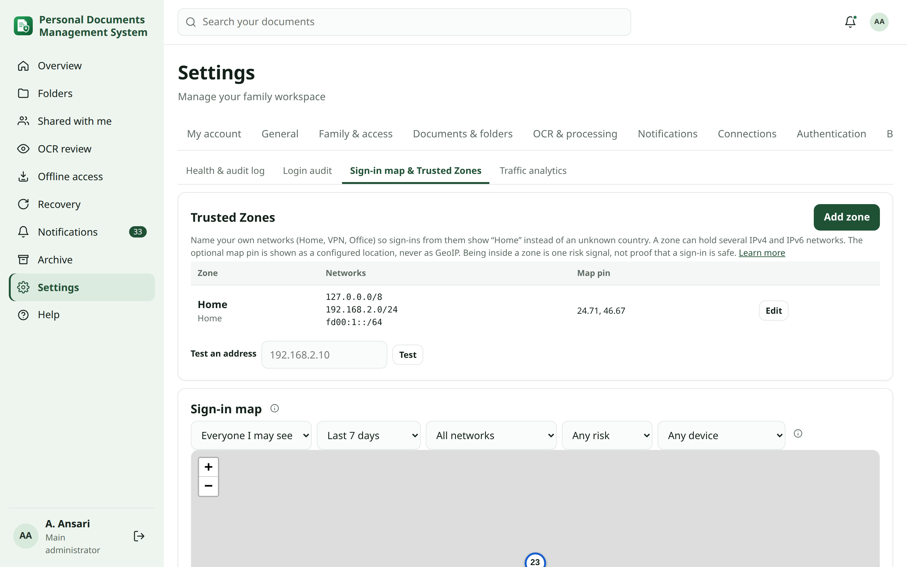
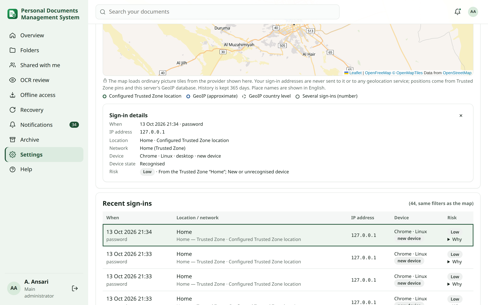
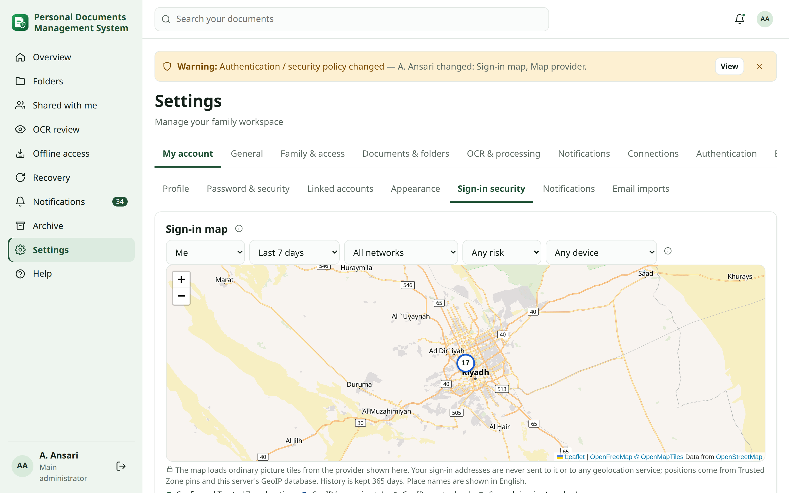
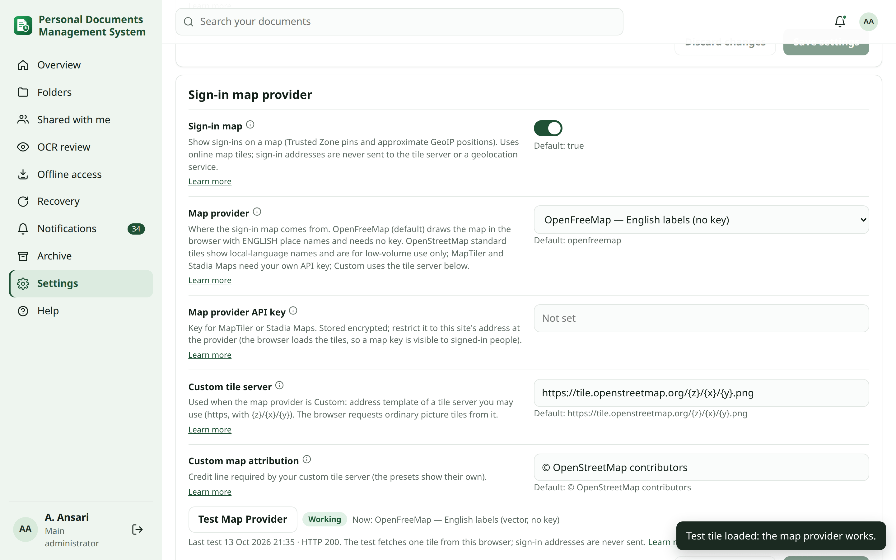
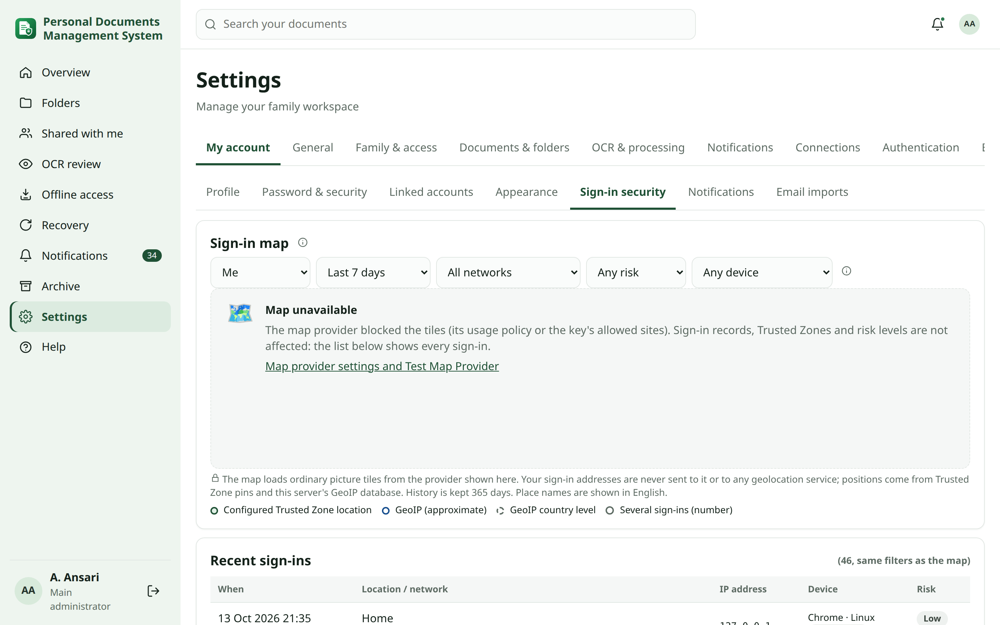
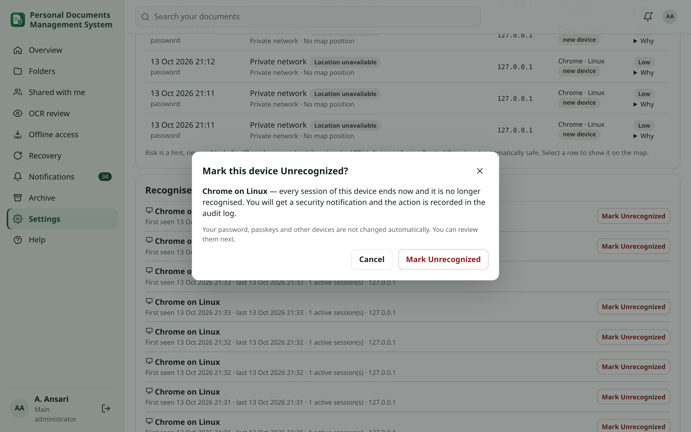

<!-- reviewed: 2026-10-13 -->
# Sign-in security, Trusted Zones and the sign-in map

Personal DM records where each sign-in came from, which device was used, and how unusual it looks. It also lets you
end sessions or distrust a device.

<!-- audience-section: main_admin -->
## Trusted Zones {#trusted-zones}

A **Trusted Zone** gives a friendly name to your own networks. With a zone such as *Home*, sign-ins from your home
network show **Home** instead of a misleading "Unknown country".

**Set up a zone (main administrator):**

1. Open **Settings → Activity & health → Sign-in map & Trusted Zones**.
2. Click **Add zone**.
3. **Friendly name:** for example `Home`, `VPN` or `Office`.
4. **Networks:** one CIDR per line. IPv4 and IPv6 can be mixed, for example `192.168.2.0/24`, `192.168.20.0/24`
   (a second VLAN) and `fd00:1::/64`.
5. **Type:** Home, VPN, Office, Family or Other.
6. Optional: a **map pin** (see below).
7. Click **Save**.
8. Use **Test an address** to check which zone an address belongs to. The address is not sent anywhere.

Rules:

- When networks overlap, the most specific one wins. A `/24` inside a `/16` belongs to the `/24`'s zone. This is
  deterministic.
- A Trusted Zone is **one** risk signal. A sign-in from Home is not automatically safe.

### Map pin {#pins}

A pin places the zone on the map. Enter latitude and longitude in decimal degrees; an approximate point is enough. The
map always labels it **configured Trusted Zone location**, never GeoIP.
<!-- /audience-section -->

## How a location is worked out {#resolution}

1. If the address belongs to a **Trusted Zone**, the location is the zone name. In notifications the network reads
   *Home — Trusted Zone*.
2. If it is another private or local address, it reads *Private network*.
3. If it is a public address, the server's own **GeoIP database** (MaxMind format) is used. A City database gives an
   approximate place and point. A Country database gives only the country, shown as a dashed country-level circle.

> [!NOTE]
> **Privacy** Sign-in addresses are never sent to Google Maps, the tile server or any other geolocation service. Private
> addresses are never looked up at all. GeoIP is approximate: mobile networks and VPNs often appear somewhere else.

## Sign-in map {#map}

**My account → Sign-in security** shows your own sign-ins:

- the map;
- **Recent sign-ins**, with time, location and network, IP address, device and risk;
- **Recognised devices**.

Place names on the map are always in **English** (with the Latin spelling where no English name exists), whatever the
browser or device language. There is no language choice to make.

### Filters {#filters}

The map and the list use the same filters, and change together:

| Filter | Choices |
| --- | --- |
| Period | **Today**, **Last 7 days** (default), **Last 30 days**, **Last 90 days**, **Last year**, **Custom range…** (from / to) |
| Person | Shown to the main administrator (everyone) and to membership delegates (their group). |
| Trust | Trusted Zone, outside Trusted Zones, or one zone (main administrator). |
| Risk | Normal, low, warning, high. |
| Device | Recognised, unrecognised, new device. |

Sign-in records are kept for one year (see [Retention](#retention)), so **Last year** is the longest period.

### Markers, groups and details {#markers}

- **Point at a marker** (or focus it with the keyboard) to see the person, the IP address and the place or Trusted Zone.
- **Click or tap a marker** to open all details next to the map: time, person, IP address, place and how it was
  worked out, network, Trusted Zone, device, browser and system, risk and result.
- Sign-ins at the same place, or too close to tell apart at the current zoom, are **grouped** in a circle with a number.
  Its colour is the highest risk in the group. Click it for the list of those sign-ins; zoom in to separate them.
- **Click a row in the list** to select it: the map moves to it and highlights its marker.
- A sign-in without a usable location is listed with **Location unavailable** and has no marker.

Who can see what:

| Person | Sees |
| --- | --- |
| Everyone | Their own sign-ins, map and devices, with full IP addresses. |
| A delegate with the *membership* scope of a family group | The members of that group. |
| Main administrator | Everyone (also under Settings → Activity & health → Sign-in map & Trusted Zones). |

Routine notifications show only the approximate location and network. For a Trusted Zone they show a shortened private
address (for example `192.168.x.10`). The full public address is under **View Security Details** in the app.

<!-- audience-section: main_admin -->
### Map provider and tiles {#provider}

The map is drawn with Leaflet and MapLibre, which are bundled with the app, using **online map data** from a provider you
choose. The provider sees which map area is shown and this site's address, like any web map, but **never your sign-in
addresses**.

The default, **OpenFreeMap**, delivers OpenStreetMap *vector* tiles: the browser draws the map itself and can choose
the English name of every place. Picture-tile providers (OpenStreetMap standard, MapTiler, Stadia, custom) send
finished images whose labels are in the local language, which is why the map showed, for example, Arabic place names
before this release. A browser without WebGL falls back to OpenStreetMap standard tiles.

**Choose the provider (main administrator):** Settings → Security → **Access policy** → **Sign-in map provider**.

| Provider | When to use it | What you need |
| --- | --- | --- |
| **OpenFreeMap** (default, English labels) | Everyday use. | Nothing: free, no key, attribution visible ([OpenFreeMap terms](https://openfreemap.org/)). Your reverse proxy CSP must allow `https://tiles.openfreemap.org`. |
| **OpenStreetMap standard** | An occasional look; labels are in the local language. | Nothing. Follow the [OpenStreetMap tile usage policy](https://operations.osmfoundation.org/policies/tiles/): low volume, attribution visible. |
| **MapTiler** | Regular use, or if OpenStreetMap blocks you. | Your own free or paid API key, restricted to this site's address. |
| **Stadia Maps** | The same. | Your own API key, restricted to this site's address. |
| **Custom / self-hosted** | You run a tile server, or have another provider. | An `https://…/{z}/{x}/{y}.png` address and its attribution. |

1. Choose the **Map provider**.
2. For MapTiler or Stadia Maps, paste the **API key** (stored encrypted). For Custom, enter the **Custom tile server**
   and **Custom map attribution**.
3. Click **Save settings**.
4. Click **Test Map Provider**.

**Expected result:** the badge shows **Working** with the time of the test. The test loads one tile from your own browser,
exactly as the map does.

> [!NOTE]
> **Privacy** The browser loads the tiles, so a map provider's API key is visible to signed-in people. That is normal
> for web maps: restrict the key at the provider to this site's address. Sign-in addresses, Trusted Zones and risk data
> are never sent to the provider.
<!-- /audience-section -->

### When the map is unavailable {#unavailable}

If the provider refuses the tiles, the card shows **Map unavailable** with the reason, instead of a grid of broken
pictures. It does not retry the tiles in a loop. Sign-in records, Trusted Zones, GeoIP locations and risk levels keep
working, and the list below the map shows every sign-in. Administrators get a link to the provider settings.

<!-- audience-section: main_admin -->
### Map troubleshooting {#map-troubleshooting}

| Test result | Meaning | Fix |
| --- | --- | --- |
| **HTTP 401** | The provider refused the API key. | Check or replace the key; make sure it is active. |
| **HTTP 403** | The provider blocked the tiles. For OpenStreetMap, its usage policy was not met (for example, a proxy strips the `Referer` header, or traffic is too high). For keyed providers, the key does not allow this site's address. | Use your own MapTiler/Stadia key, add this site's address to the key's allowed domains, or check the reverse proxy. |
| **HTTP 429** | Too many requests. | Wait, or use a provider with a higher quota. |
| *Could not be reached* | Network, DNS, TLS, or a Content-Security-Policy set by your reverse proxy blocks the tile server. | Allow the provider's address for images and connections in the proxy's CSP (for OpenFreeMap: `https://tiles.openfreemap.org` in `connect-src`). |
| Labels are not in English | A picture-tile provider is selected, or the browser has no WebGL (a note under the map says so). | Choose **OpenFreeMap**, or enable hardware acceleration in the browser. |
| *No status* | The custom server does not send CORS headers, so the test cannot read its answer. | Open the map: if tiles show, it works. |

> [!IMPORTANT]
> **Why maps showed "Access blocked" before this release:** for privacy, the app sent no `Referer` at all with any
> request. OpenStreetMap's tile servers refuse anonymous tile requests. Tile requests now carry only this site's origin,
> for example `https://docs.example.com/`, never a page path. Nothing tries to get around a provider's policy: no fake
> browser identity, no proxying of tiles and no endless retries.

Turn **Sign-in map** off to show only the list.
<!-- /audience-section -->

## Risk {#risk}

Every successful sign-in gets an explainable risk level. Open **Why** to see the reasons.

| Example | Usual level |
| --- | --- |
| Home + recognised device | **Normal** |
| Home + new device | **Low** |
| New device on another private network (not a Trusted Zone) | **Low** |
| Known public place + recognised device | **Normal** |
| New country, or a new device on a public network | **Warning** |
| Impossible travel: far away from the previous sign-in, faster than a plane (needs City-level GeoIP) | **High** — you and the administrators get an *Unusual sign-in* notification |

The signals used are: Trusted Zone, recognised device, sign-in method (passkey, authenticator code, single sign-on or
password only), GeoIP country and location history, and unusual changes of location.

> [!IMPORTANT]
> Risk is a hint. A sign-in is **never** blocked only because GeoIP says the location changed. Blocking by country
> is a separate, deliberate setting: see [country and IP rules](security-access.md#country-policy).

## Recognised devices {#devices}

A device is recognised by a random, long-lived cookie stored in that browser or app; only a hash of it is kept on the
server. The list shows each device's name, first and last use, active sessions and last address. **This device** marks
the one you are using.

To end one session without distrusting the device, use **My account → Password & security → Sessions**.

## Mark Unrecognized {#unrecognized}

Use this when you do not recognise a device.

1. Click **Mark Unrecognized** next to the device and confirm.
2. Personal DM then:
   - ends every active session of that device;
   - removes its recognition (its cookie is never trusted again: the next sign-in counts as a new device);
   - records a security event in the audit log;
   - sends you a security notification.
3. It then **offers** next steps. None of them is done automatically:
   - **Sign out all other sessions**;
   - **Change password**;
   - **Review passkeys**;
   - **Review linked sign-in methods** (Google, authentik);
   - **Review recent sign-ins**.

Passkeys, the authenticator app and the password stay as they are until you change them.

## Retention {#retention}

Sign-in records, map points and device history follow the security log retention: **1 year** by default (*Login audit
retention* in Settings → Security). Devices that still have an active session are never removed by the cleanup.
