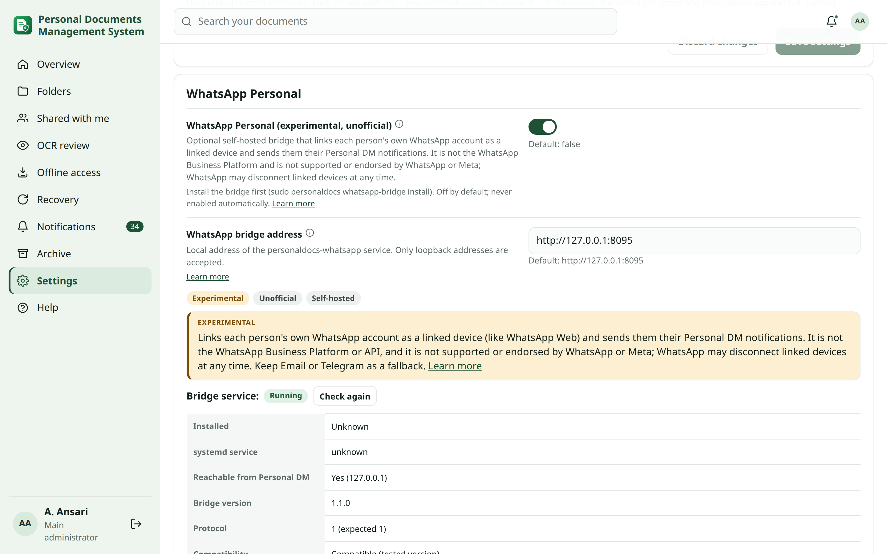
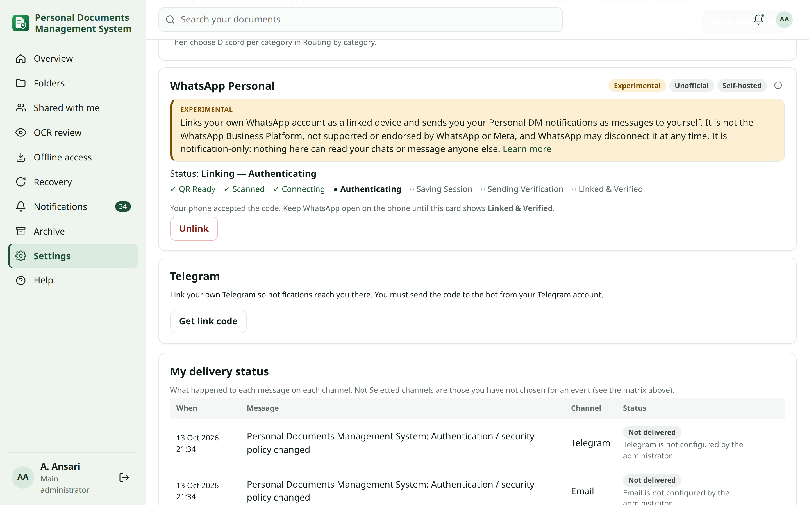
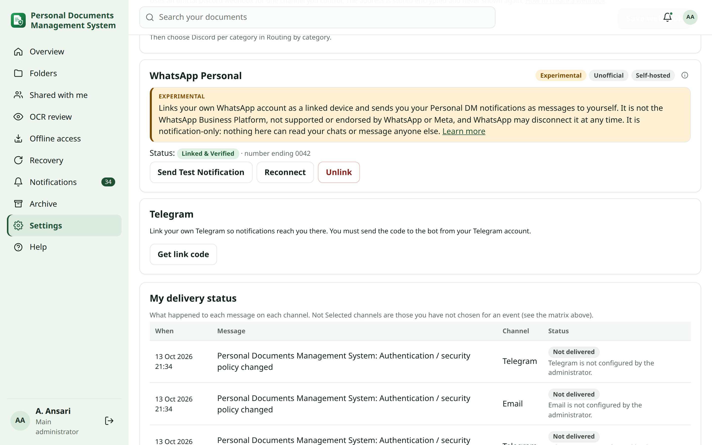
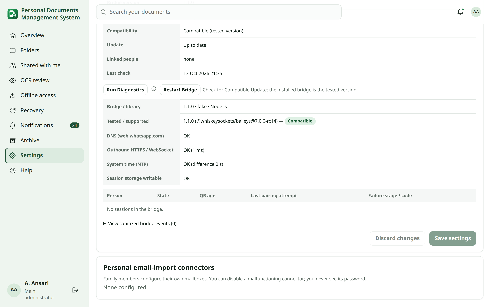

<!-- reviewed: 2026-10-13 -->
# WhatsApp Personal (experimental)

> [!WARNING]
> **Experimental. Unofficial. Self-hosted.** WhatsApp Personal links your own WhatsApp account to Personal DM as a
> linked device and sends you your notifications as messages to yourself. It is **not** the WhatsApp Business Platform.
> It is **not** supported or endorsed by WhatsApp or Meta. WhatsApp can disconnect linked devices or change its
> protocol at any time, and such use may conflict with WhatsApp's terms. Use it at your own risk, and keep another
> channel (Email or Telegram) in your [fallback chain](notifications.md#fallback).

## What it is and is not {#scope}

- **Notification-only.** It sends Personal DM notifications (expiry, sharing, security and sign-in, backup and recovery,
  storage and system, OCR and antivirus, digests) to **your own** WhatsApp account only.
- It has **no** message composer, bulk or marketing sending, contact list, chat reading, automatic replies or general
  messaging.
- Each person links their own account. One person's session can never send as someone else.
- If the bridge stops or WhatsApp breaks compatibility, Personal DM and every other channel keep working.

<!-- audience-section: main_admin -->
## Install and enable (administrator) {#enable}

1. On the server, run:

   ```
   sudo personaldocs whatsapp-bridge install
   ```

   This installs Node.js from Debian if needed, and the **tested, pinned** bridge version. It then runs a self-test and
   starts the service `personaldocs-whatsapp` (listening on `127.0.0.1:8095` only).
2. Open **Settings → Connections** and scroll to **WhatsApp Personal**. The **Bridge service** panel shows what the
   server really reports:

   | Row | Expected value |
   | --- | --- |
   | Installed | Yes |
   | systemd service | active |
   | Reachable from Personal DM | Yes (127.0.0.1) |
   | Bridge version / Protocol | 1.0.0 / 1 (expected 1) |
   | Compatibility | Compatible (tested version) |

   Before you turn it on, the badge reads **Installed and running - turned off**.
3. Turn on **WhatsApp Personal (experimental, unofficial)** and click **Save settings**. The badge changes to
   **Running**. No restart is needed: everyone can link their phone at once.



The screenshot comes from the test system, which has no systemd and uses the test bridge, so *Installed* and
*systemd service* show **Unknown** there. On a server installed with `personal-DM.sh` they show **Yes** and **active**.

It is off by default and is never turned on automatically, also not on upgrade. At the top of **Settings → Connections**,
the **Notification providers** cards show every channel with its scope, status and a **Configure** link.

| Bridge badge | Meaning | Fix |
| --- | --- | --- |
| **Not installed** | The bridge files are missing. | `sudo personaldocs whatsapp-bridge install` |
| **Service stopped** / **Service unavailable** | systemd reports the service inactive, or it does not answer on 127.0.0.1. | `sudo systemctl start personaldocs-whatsapp`; `journalctl -u personaldocs-whatsapp -n 50` |
| **Incompatible bridge version** | The bridge speaks another protocol. | `sudo personaldocs whatsapp-bridge update` or `rollback` |
| **Degraded (untested version)** | Compatible protocol, but not a tested version. | `sudo personaldocs whatsapp-bridge update` |

While the bridge is unavailable, people see **Service unavailable** on their card and their fallback channels are used.
Other channels are never affected.

### The bridge {#bridge}

| Item | Detail |
| --- | --- |
| Service | `personaldocs-whatsapp` (systemd). Bounded restarts: after 5 failures in 15 minutes it stops, and an incompatible library version is never restarted. |
| Address | `http://127.0.0.1:8095` (*WhatsApp bridge address*). Only loopback addresses are accepted. |
| Access | A random token in `/etc/personaldocs/whatsapp-bridge.token`. |
| Sessions | One encrypted file per linked person in `/var/lib/personaldocs/whatsapp/sessions/`. They are part of the encrypted backup's secrets package. |
| Version | Pinned in `bridge/whatsapp/compat.json`, together with the compatibility, licence and security review in `bridge/whatsapp/README.md`. |
<!-- /audience-section -->

## Link your WhatsApp {#link}

1. Open **My account → Notifications → WhatsApp Personal** and click **Link WhatsApp**.
2. On your phone, open **WhatsApp → Settings → Linked devices → Link a device**.
3. Scan the QR code shown in Personal DM. The card shows **Expires in m:ss**: one link attempt stays valid for
   **5 minutes**.
4. Keep the page open. The card walks through **QR Ready → Scanned → Connecting → Authenticating → Saving Session →
   Sending Verification**, then shows **Linked & Verified** and the last digits of your number.

   
5. A verification message (*✅ Personal DM: WhatsApp Personal is linked. …*) arrives in your "Message
   yourself" chat. **Send Test Notification** sends another one at any time.
6. Choose **WhatsApp Personal** per category in [Routing by category](notifications.md#routing), ideally as the first
   item of a fallback chain.

> [!NOTE]
> **Why the picture changes during the 5 minutes:** WhatsApp itself renews the QR code about every 20–30 seconds, and
> a code older than that cannot be scanned. Personal DM keeps the same link attempt open for 5 minutes and shows each
> new code automatically, so you can scan whenever you are ready. It does not create new attempts on its own, and
> **Generate new QR code** is offered only when the window has ended or linking failed.

> [!NOTE]
> **Privacy** The QR code is shown only to you, while you are linking. It is never stored, logged or included in
> screenshots, notifications, backups or diagnostics. The linked-device credentials stay in the bridge, encrypted per
> person. Personal DM's database stores only the state and the last digits of the number.

## States {#states}

| State | Meaning and what to do |
| --- | --- |
| **QR Ready** | Scan the code before the countdown ends. |
| **Scanned / Connecting / Authenticating / Saving Session / Sending Verification** | Linking is in progress. Keep WhatsApp open on the phone until it finishes. |
| **Linked & Verified** | The verification message was delivered. Notifications are delivered. |
| **Linked — Verification Pending** | Linked; the verification message is being sent. |
| **Linked — Test Failed** | Linked, but the last test message failed. Click **Send Test Notification**; if it fails again, **Relink (new QR code)**. |
| **QR code expired** | The 5 minutes ended without a scan. Click **Generate new QR code**. |
| **Pairing failed** | The card says at which step and why (for example, *the phone did not finish linking in time*). Click **Generate new QR code**. |
| **Disconnected — reconnecting** | Temporary. The bridge reconnects by itself with growing pauses (up to 5 minutes); the card shows the next attempt. Messages wait in the queue meanwhile. |
| **Relink Required** | WhatsApp ended the linked-device session (removed on the phone, logged out, or a Compromise recovery). You also get a notification through another channel. Link again with a new QR code. |
| **Compatibility error** | WhatsApp changed its protocol and the bridge needs a tested update. The main administrator is notified by email or Telegram. |
| **Service unavailable** | The administrator turned it on, but the bridge does not answer. Your fallback chain is used meanwhile. |
| **Disabled by Admin** | WhatsApp Personal is turned off for the installation. |



**Reconnect** asks the bridge to restore the connection without a new QR code. **Unlink** logs the linked device out
and deletes the session.

### Messages that wait {#queue}

When WhatsApp is temporarily unavailable, messages wait in the queue and are sent when the link is back, or the next
channel in your fallback chain is used. Delivery history shows the outcome: **Delivered**, **Failed**, **Fallback**,
**Expired** (a routine message older than 24 hours is not sent late) or **Superseded** (a newer message about the same
thing replaced it). Security and critical messages never expire.

<!-- audience-section: main_admin -->
## Diagnostics (main administrator) {#diagnostics}

**Settings → Connections → WhatsApp Personal → Run Diagnostics** checks, without exposing any secret:

- bridge version, protocol library version and tested version;
- name lookup and HTTPS reachability of `web.whatsapp.com` (a proxy or firewall that blocks WebSockets shows here);
- system time against WhatsApp's servers (more than a minute off breaks linking: fix NTP);
- that the encrypted session folder is writable;
- per person: state, current linking step, last error code;
- recent bridge events (time and step only).



QR codes, keys, phone numbers and message text are never part of diagnostics. **Restart Bridge** restarts the bridge
service; linked sessions reconnect by themselves.

## Updates and rollback {#updates}

```
sudo personaldocs whatsapp-bridge status     # installed and tested version, service, bridge health
sudo personaldocs whatsapp-bridge update     # only to the version tested with this Personal DM release
sudo personaldocs whatsapp-bridge rollback   # back to the previous bridge version
sudo personaldocs whatsapp-bridge disable    # stop the bridge and turn the feature off
```

An update first archives the encrypted sessions. It then installs the new version next to the old one, runs a self-test
and a health check, and switches over only when both pass; otherwise it rolls back automatically. Upstream releases are
never followed automatically. When Personal DM ships a newly tested version, the delivery-health card says *a tested
update is available*. Updates are audited. After an update, the command prints the diagnostics.

Bridge **1.1.0** (this release) uses the maintained protocol library `@whiskeysockets/baileys` **7.0.0-rc14** (MIT; its
signal-protocol dependency is GPL-3.0, installed separately by npm). The previous library line is no longer
maintained. Run `sudo personaldocs whatsapp-bridge update` once after upgrading Personal DM, then everyone links again.
<!-- /audience-section -->

## After a recovery {#recovery}

- **Normal disaster recovery:** the encrypted sessions are restored and reconnected. A session WhatsApp rejects shows
  **Reconnect Required**.
- **Compromise recovery:** restored sessions are never trusted. Everyone links again with a new QR code.

## Troubleshooting {#troubleshooting}

| Symptom | Fix |
| --- | --- |
| The phone stays on **Connecting** and never links | Click **Generate new QR code** and scan again with WhatsApp open on the phone. If it happens again, ask your administrator to update the WhatsApp bridge. |
| The QR code never appears | The card says why (for example *Service unavailable*). Ask your administrator. |
| Linking fails at **Authenticating** | Your account reached WhatsApp's limit of linked devices: remove an old one under **Linked devices** on the phone, then try again. |
| Messages stop after a while | WhatsApp ended the session: link again. Keep Email or Telegram in your fallback chain. |

<!-- audience-section: main_admin -->
### For the main administrator {#troubleshooting-admin}

| Symptom | Fix |
| --- | --- |
| *The WhatsApp bridge is not running* | `sudo systemctl status personaldocs-whatsapp` and `journalctl -u personaldocs-whatsapp -n 50`, then `sudo personaldocs whatsapp-bridge install`. |
| Install says *the pinned WhatsApp library is missing* (`Cannot find package '@whiskeysockets/baileys'`) | Fixed in the release after Change Set T: the first install installed the library readable only by root. Upgrade (`sudo personaldocs upgrade`) and run `sudo personaldocs whatsapp-bridge install` again. Nothing was changed by the failed attempt. |
| *Incompatible bridge version* | `sudo personaldocs whatsapp-bridge update` (tested version) or `rollback`. |
| Phones stay on **Connecting** and never link | Fixed in bridge 1.1.0 (WhatsApp asks for a restart right after the scan; bridge 1.0.0 did not reconnect). Run `sudo personaldocs whatsapp-bridge update`; people then click **Generate new QR code**. |
| The QR code never appears | **Run Diagnostics**: DNS, HTTPS/WebSocket access to `web.whatsapp.com` through the proxy or firewall, system time (NTP), session storage. |
| Linking fails at **Authenticating** for everyone | System time is wrong: check `timedatectl` and NTP. |
<!-- /audience-section -->
